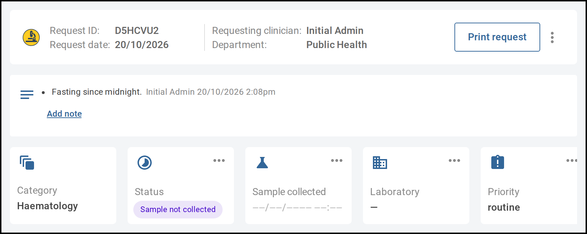
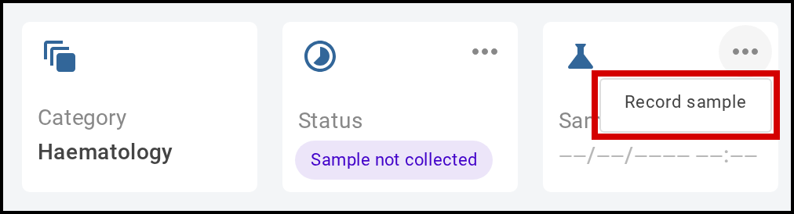
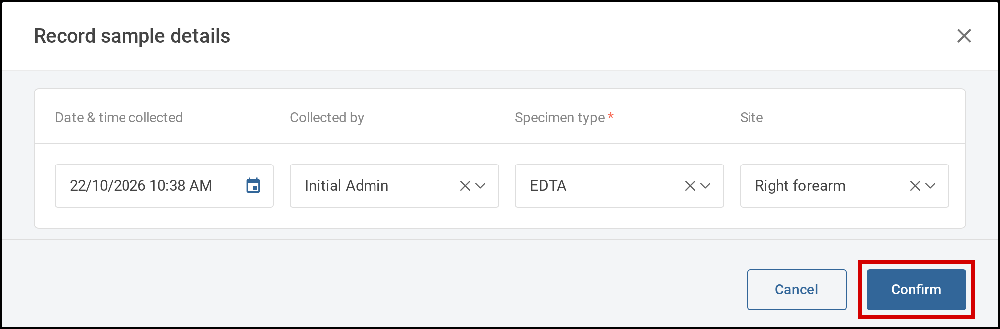

A lab request made before its sample was collected shows **Sample not collected**. Once the sample has
been taken, you record it on the request, starting from the **Labs** tab of the patient's encounter.
The request can't move on until its sample is recorded.

# Steps

1. On the encounter's **Labs** tab, select the request. The lab request opens.

   

      
     A request without a sample shows <b>Sample not collected</b>.
   

2. On the **Sample collected** tile, select the three dots, then **Record sample**. The **Record sample
   details** window opens.

   

      
     Select the three dots on <b>Sample collected</b>, then <b>Record sample</b>.
   

3. Enter the **Date & time collected**. **Collected by** fills in with your name, and **Specimen type**
   may fill in with the usual type for the request's category. Check or change **Collected by**,
   **Specimen type** and **Site**.

   

      
     Check the sample details, then select <b>Confirm</b>.
   

4. Select **Confirm**. The **Sample collected** tile shows the date and time collected and the
   specimen type, and the status changes to **Reception pending**.

   If your site prints sample labels automatically, the label print screen opens. Select
   **Print labels** to print the sample's label, or **Cancel** to close the screen.
