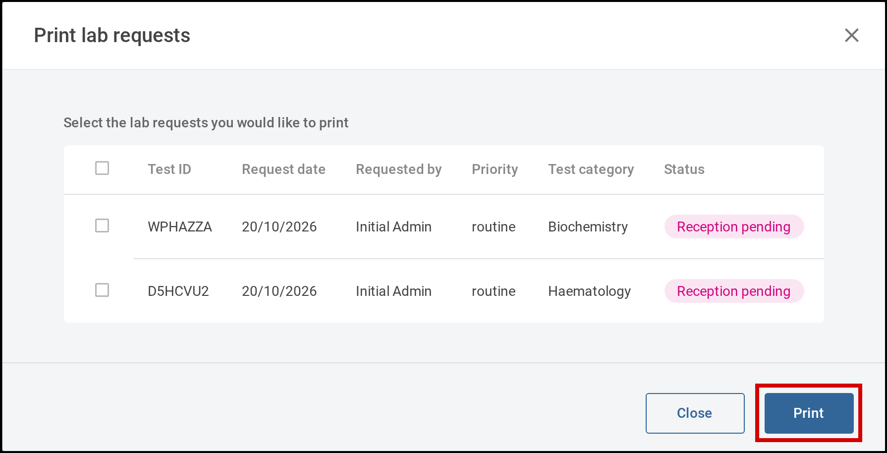
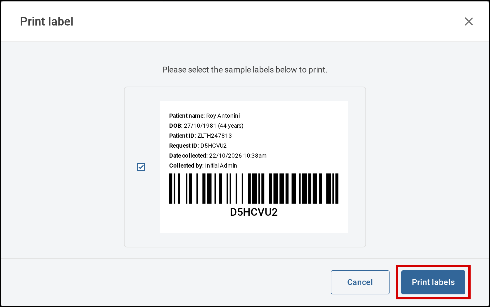

You can print lab request forms to send with samples, and sample labels to stick on the sample
containers. Print several of a patient's requests at once from the **Labs** tab of their encounter, or
one request or label from the request itself. You can also print them straight after making a request
(see [17.1 Request lab tests](01-request-lab-tests.md)).

# Steps

## Print several requests

1. On the encounter's **Labs** tab, select **Print**. The **Print lab requests** window opens.

   

      
     Tick the requests to print, then select <b>Print</b>.
   

2. Tick the requests you want to print, then select **Print**.

## Print one request

1. On the encounter's **Labs** tab, select the request. The lab request opens.
2. Select **Print request**. A preview of the request form opens.

   **[Screenshot: the lab request form preview]**

3. Select **Print**.

## Print a sample label

1. On the encounter's **Labs** tab, select the request. The lab request opens.
2. Select the three dots beside **Print request**, then **Print label**. The **Print label** window
   opens with a preview of the sample label. The label shows the patient's details, the request ID as a barcode, and the sample's
   collection details.

   

      
     Check the label, then select <b>Print labels</b>.
   

3. Select **Print labels**.
