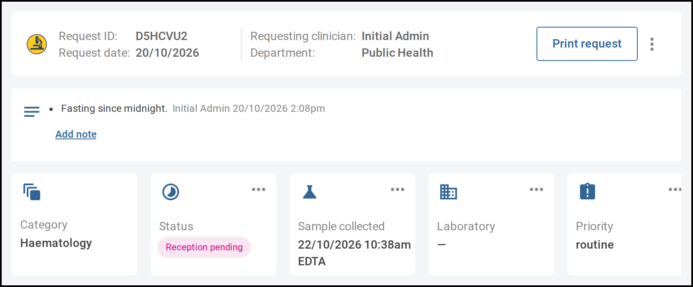

As a lab request moves through the laboratory, you update its status, and you can change the
laboratory handling it or its priority. You can also correct a recorded sample and add notes. Start
each from the lab request: on the **Labs** tab of the patient's encounter, select the request.

A rejected, cancelled or invalidated request can't be changed. Which changes you can make also depends
on your account's permissions. If you believe you should be able to make a change you can't, contact
your system administrator.

   
  Each change starts from a tile on the lab request.

# Steps

## Change the status

1. On the **Status** tile, select the three dots, then **Change status**. The **Change lab request
   status** window opens. You can't change the status until the request's sample is recorded, and
   entering results doesn't change it, so change it as your laboratory's process requires.
2. Choose the new **Status**, then select **Confirm**. The **Status** tile shows the new status.

   **[Screenshot: the Change lab request status window]**

## View the status history

1. On the **Status** tile, select the three dots, then **View status log**. The **Status Log** window
   lists each status the request has had, with the date and time and who recorded it.

## Change the laboratory

1. On the **Laboratory** tile, select the three dots, then **Change laboratory**.
2. Choose the **Laboratory** that will handle the sample, then select **Confirm**.

## Change the priority

Some sites don't allow a request's priority to be changed after it is made.

1. On the **Priority** tile, select the three dots, then **Change priority**.
2. Choose the **Priority**, then select **Confirm**.

## Correct a recorded sample

1. On the **Sample collected** tile, select the three dots, then **Edit**. The **Edit sample** window
   opens. To check the sample's details without changing them, select **View details** instead.
2. Correct the details, then select **Confirm**.

## Add a note

1. Below the request details, select **Add note**.
2. Type the note and save it. The note appears with your name and the date and time.
