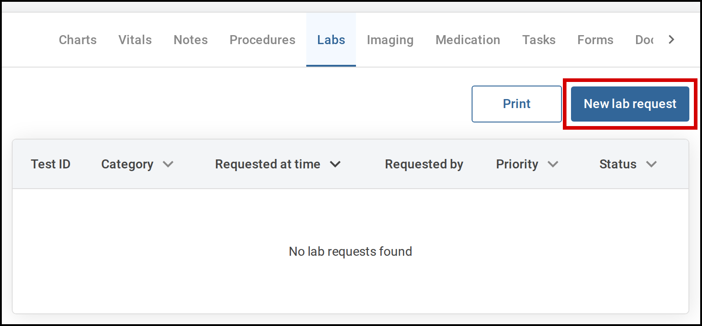
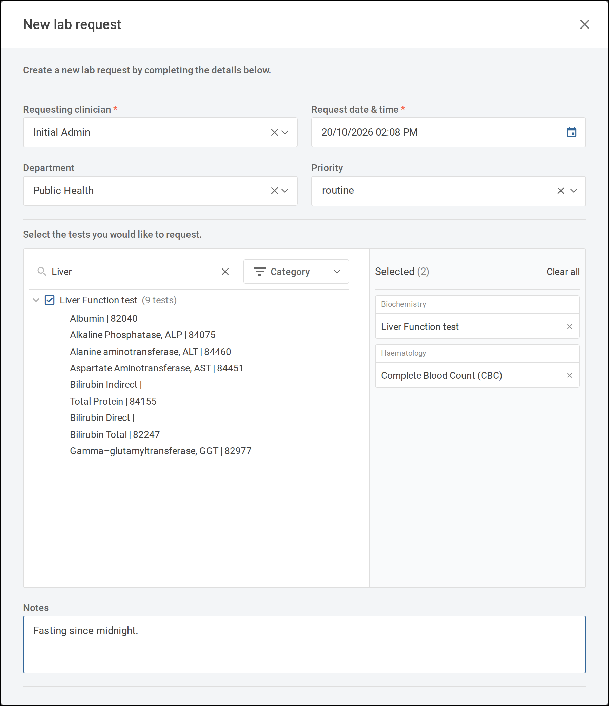
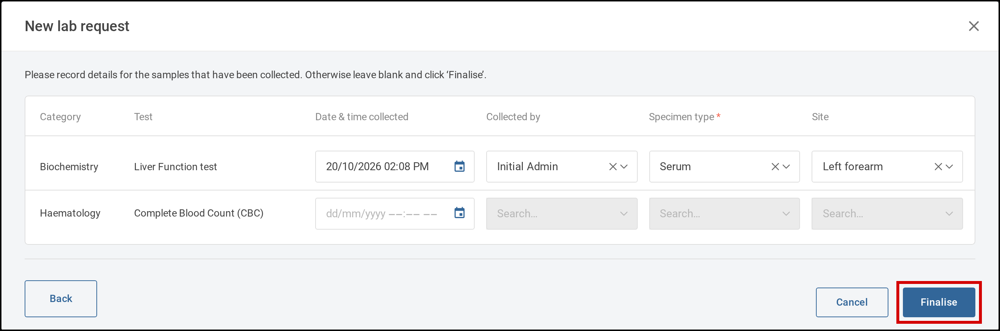
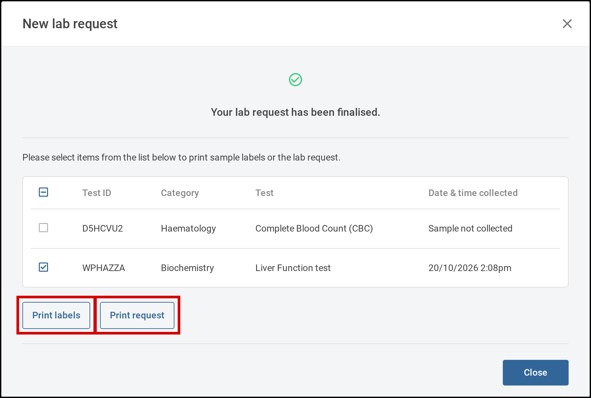

You request lab tests from the **Labs** tab of a patient's current encounter. You choose the tests
and panels on one screen, then record any samples you have already collected. Tamanu makes one lab
request for each test category you order from.

# Steps

1. Open the patient's current encounter and select the **Labs** tab.

   

      
     Select <b>New lab request</b> on the encounter's <b>Labs</b> tab.
   

2. Select **New lab request**. The **New lab request** window opens.
3. Check the request details at the top of the window, and change any that are wrong:
   - **Requesting clinician** is filled in with your name
   - **Request date & time** is filled in with the current date and time
   - **Department** is filled in with the encounter's department
   - **Priority** is optional unless your site requires it
4. Select the tests and panels you want. Tests are grouped by category, and each panel shows how many
   tests it contains.
   - To find a test or panel, type its name in **Search test or panel**, or choose a category from
     **Category**
   - To see the tests in a panel, select the arrow beside it
   - Selecting a panel greys out the tests it already contains, so the same test can't be ordered
     twice
   - Your choices are listed under **Selected**, grouped by category. To remove one, select the
     **×** beside it. To remove them all, select **Clear all**

   

      
     Choose tests and panels, then select <b>Next</b>.
   

5. Add anything the laboratory should know in **Notes**, then select **Next**. **Next** is available
   once you have selected at least one test or panel.
6. Record the samples you have collected. Each test category has its own row. For each sample:
   - Enter the **Date & time collected**. **Collected by** fills in with your name, and **Specimen type**
     may fill in with the usual type for that category
   - Check or change **Collected by**, **Specimen type** and **Site**
   - Where your site requires a specimen type, **Specimen type** is marked with a red asterisk

   Leave a row blank if its sample hasn't been collected yet. You can record it later (see
   [17.2 Record a sample](2-record-a-sample.md)).

   

      
     Record the samples collected, then select <b>Finalise</b>.
   

7. Select **Finalise**. Tamanu shows **Your lab request has been finalised.** and lists a request for
   each category, with its **Test ID**. To print sample labels or the request form, tick the requests
   and select **Print labels** or **Print request** (see
   [17.3 Print lab requests and labels](3-print-lab-requests-and-labels.md)). Then select **Close**.
   The requests appear on the encounter's **Labs** tab. A request with a recorded sample shows
   **Reception pending**, and one without shows **Sample not collected**.

   If your site prints sample labels automatically and you recorded every sample, the label print
   screen opens instead. Select the labels to print and print them.

   

      
     Print sample labels or the request, or select <b>Close</b>.
   

