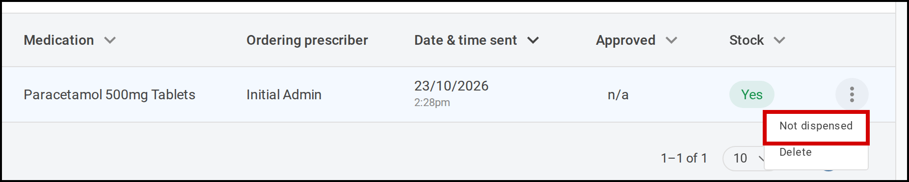
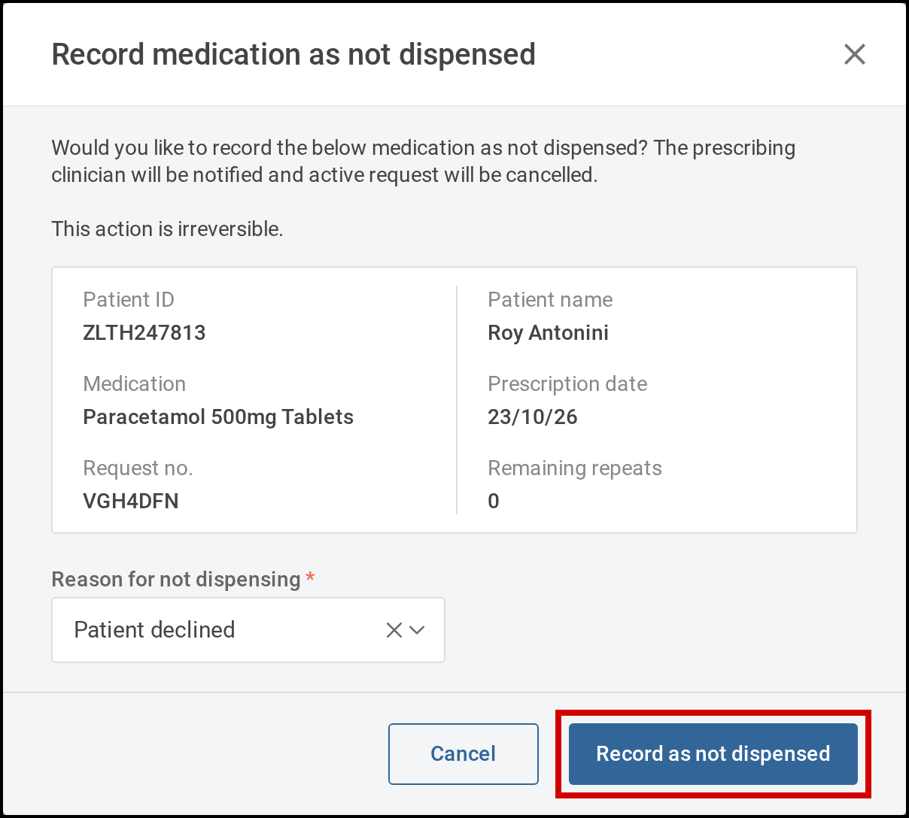
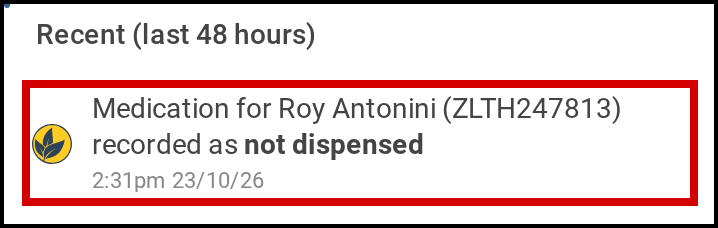
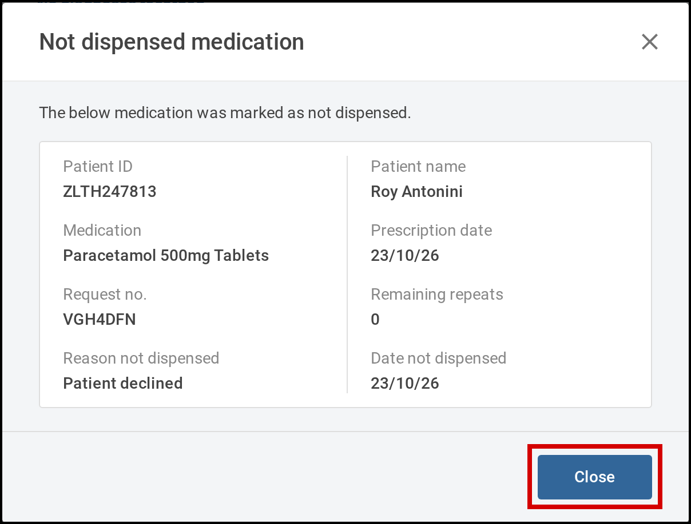

When the pharmacy can't dispense a medication request, you record it as not dispensed. Start from
**Medication** > **Active requests**. Tamanu cancels the request and lets the prescribing clinician
know, so they can see why and prescribe again if needed.

# Before you start

Recording a medication as not dispensed needs permission to delete medication requests. If you believe
you should be able to do it, contact your system administrator.

# Steps

## Record a medication as not dispensed

1. In the menu on the left, select **Medication**, then **Active requests**. The **Active medication
   requests** list opens.
2. Find the request. Fill in any of the search fields, such as **Patient ID**, **First name**,
   **Last name** or **Medication**, then select **Search**.
3. Select the three dots at the end of the request's row, then **Not dispensed**. The **Record
   medication as not dispensed** window opens.

   

      
     Select the three dots on the request's row, then <b>Not dispensed</b>.
   

4. Check that the window shows the right patient and medication, then choose the **Reason for not
   dispensing**. Your site sets the list of reasons.
5. Select **Record as not dispensed**. This can't be undone. The request leaves the list, and the
   prescribing clinician gets a notification.

   

      
     Choose the reason, then select <b>Record as not dispensed</b>.
   

## See why a medication wasn't dispensed

The prescribing clinician sees the not dispensed record from their notification. Opening it needs
permission to view medication requests. Without it, Tamanu shows **You do not have permission to
view medication request details.**

1. On your **Dashboard**, select the bell at the top right. The **Notifications** panel opens.
2. Select the notification **Medication for** the patient **recorded as not dispensed**. The patient's
   encounter opens on its **Medication** tab, with the **Not dispensed medication** window showing the
   **Reason not dispensed** and the **Date not dispensed**.

   

      
     Select the notification to see why the medication was not dispensed.
   

3. Select **Close**.

   

      
     The window shows the <b>Reason not dispensed</b> and the <b>Date not dispensed</b>.
   

