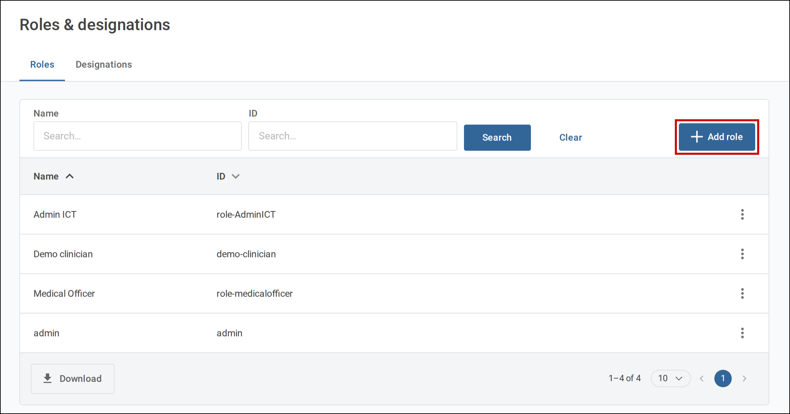
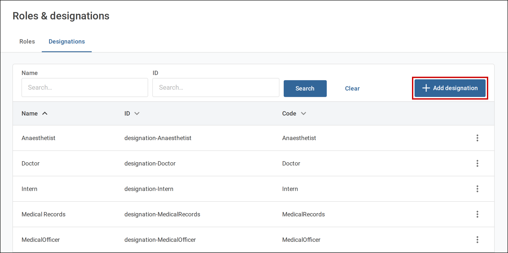
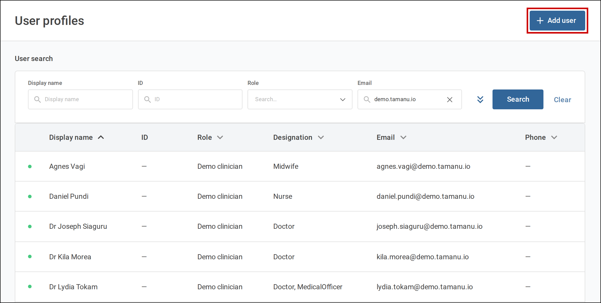
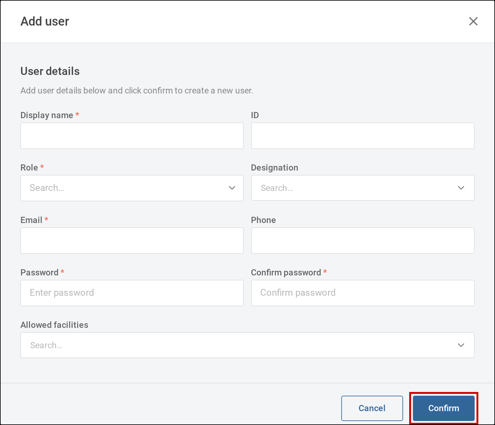
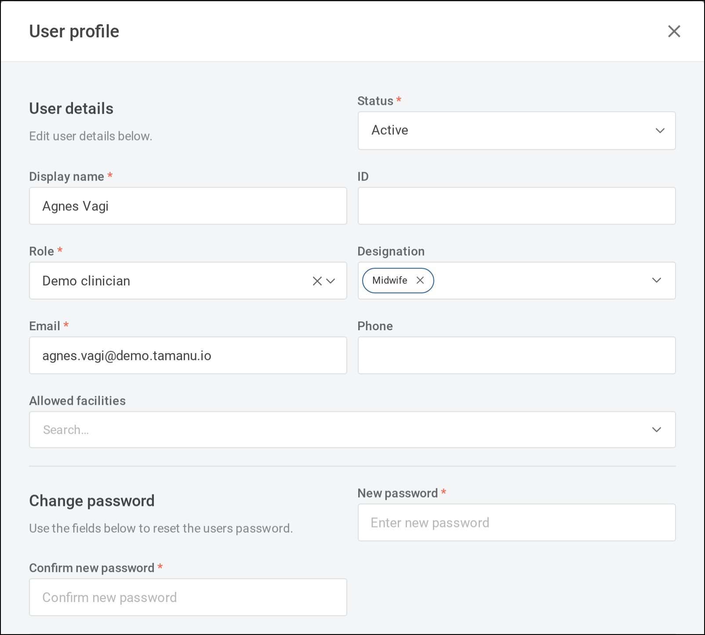
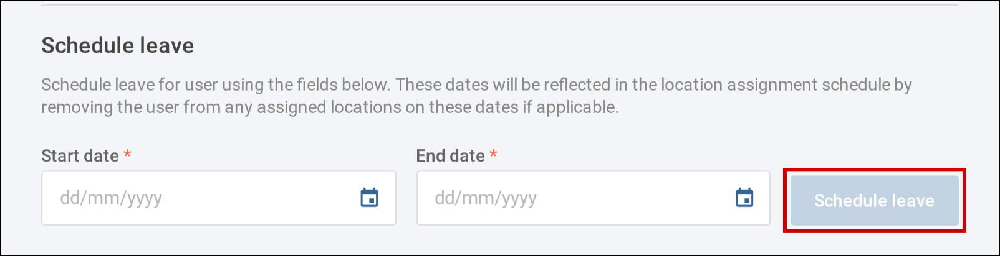

The users, designations and roles a Tamanu deployment needs. Users and designations are configured
through the reference data import spreadsheet, and roles through the `Role` tab of the permissions
matrix spreadsheet, both downloaded from and uploaded to the admin panel. Each can also be managed one
record at a time on the **Users** screens of the admin panel.

For the settings that control facility access and which permissions apply see
[Settings](02-settings.md), and for granting permissions to roles see [Permissions](03-permissions.md).

---

# Reference Data Types

See the [Tamanu Reference Data Manual](https://beyond-essential.slab.com/public/posts/tamanu-reference-data-manual-intf5xei) for how importing works.

Set up in this order, since each type refers to the ones before it:

1. Roles, on the `Role` tab of the permissions matrix
2. Designations
3. Facilities, covered in the [Deploying Tamanu](../01-deploying-tamanu/) configuration guides
4. Users
5. Permissions, on the `Permission` tab of the permissions matrix. See
   [Importing the permissions matrix](03-permissions.md#importing-the-permissions-matrix)

## Role

A role groups users who do the same kind of work, such as `Doctor`, `Nurse` or `Admin`. Each user has
one role, and the permissions matrix grants permissions to roles rather than to individual users.

| Field | Value |
| --- | --- |
| Tab name | `Role` |

Where * is a required field.

| Column name | Description |
| --- | --- |
| id * | Unique id for the role. Letters, numbers and hyphens only. This id is the column header for the role on the `Permission` tab and the value of a user's `role` column. |
| name * | Name for the role, displayed when choosing a user's role. |

The `Role` and `Permission` tabs are imported together on the **Import** tab of the **Permissions**
screen in the admin panel, not the **Reference data** screen. The `Role` tab is read first, so a
role can be added and given permissions in a single import. See
[Importing the permissions matrix](03-permissions.md#importing-the-permissions-matrix).

### Managing roles in the admin panel

Roles can also be added and deleted on the **Roles** tab of **Users** > **Roles & designations**:

- Select **Add role** and enter an **ID** and **Name**. The id must not already be in use
- Select the menu against a role, then **Delete**, to remove it. A role cannot be deleted while any user, including a
  deactivated user, is assigned to it: the screen lists those users, and each needs a different role
  first

   
  Select <b>Add role</b> on the <b>Roles</b> tab.

A role's name cannot be changed on this screen. Change it on the `Role` tab and re-import.

---

## Designation

A designation describes a user's job, such as `Nurse`, `Senior Nurse` or `Midwife`, independently of
the role that sets their permissions. Tasks are assigned to designations, so the designation decides
whose task list a task appears in. See the [Tasks](../14-tasks/) configuration guides. A user can hold
several designations, or none.

| Field | Value |
| --- | --- |
| Tab name | `Designation` |

Where * is a required field.

| Column name | Description |
| --- | --- |
| id * | Unique id for the designation, for example `designation-Nurse`. Letters, numbers and hyphens only. This id is the value used in a user's `designations` column. |
| code * | Code for the designation. Letters, numbers, hyphens, full stops and forward slashes only. |
| name * | Name for the designation, displayed on user profiles and tasks. |
| visibilityStatus | `current` for designations in use, or `historical` for designations that should no longer be assigned. Defaults to `current` if blank. Only `current` designations can be assigned to a user. |
| availableFacilities | Accepted on every reference data type, but has no effect on designations. Leave blank. |

### Managing designations in the admin panel

Designations can also be added and deleted on the **Designations** tab of **Users** >
**Roles & designations**:

- Select **Add designation** and enter an **ID**, **Code** and **Name**
- Select the menu against a designation, then **Delete**, to remove it. A designation cannot be deleted while any
  user or task is assigned to it: the screen lists them, and each needs updating first

   
  Select <b>Add designation</b> on the <b>Designations</b> tab.

Designations are reference data, so they can also be edited on the **Manage** tab of the
**Reference data** screen.

---

## User

A user is an account a person logs in to Tamanu with. Their name is recorded against everything they
do, and appears wherever staff choose a clinician.

| Field | Value |
| --- | --- |
| Tab name | `User` |

Where * is a required field.

| Column name | Description |
| --- | --- |
| id * | Unique id for the user, for example `user-jsmith`. Letters, numbers and hyphens only. Cannot be changed once the user exists. |
| displayId | A registration or staff number for the user, such as a medical council number. Printed on prescriptions. Leave blank if not required. |
| email * | The email the user logs in with. Must be unique across all users. Not case sensitive when logging in. |
| displayName * | The user's name as displayed throughout Tamanu. The importer does not check that it is unique, but the **User profiles** screen does, so keep display names distinct. |
| role | The `id` of the user's role, from the `Role` tab. Defaults to `practitioner` if blank. This column is not validated on import, so a role id that does not exist is accepted and the user can do nothing in Tamanu. |
| phoneNumber | The user's phone number. Any format is accepted. Leave blank if not required. |
| deviceRegistrationQuota | The number of new mobile devices the user may register. Defaults to `0`, so no devices, for a new user. See the [Deploying Tamanu](../01-deploying-tamanu/) configuration guides. |
| visibilityStatus | `current` for active users, or `historical` to deactivate the user. Defaults to `current` if blank. A deactivated user cannot log in, and their name stays against everything they recorded. |
| designations | The `id` of each of the user's designations, from the `Designation` tab, separated by commas. Each must exist and be `current`, or the row errors. Leave blank for none. |
| allowedFacilities | The `id` of each facility the user is linked to, separated by commas. Leave blank to link the user to no facilities. What a link grants depends on the facility access settings: see [Facility access](02-settings.md#facility-access). |
| password | The password the user logs in with. Needed to create a user who can log in, but not checked by the importer, so a new user imported without one cannot log in until a password is set. Leave blank when updating a user to keep their current password. |

> [!WARNING]
> On re-import, the `designations` and `allowedFacilities` columns replace the user's existing values
> rather than adding to them. A blank cell removes all of the user's designations or facility links.

An export writes `designations` and `allowedFacilities` back as comma-separated ids, so an exported
sheet re-imports unchanged. An export has no `password` column, and re-importing it leaves every
user's password as it was.

### Managing users in the admin panel

Users can also be added and edited one at a time on **Users** > **User profiles**.

   
  Select <b>Add user</b> on <b>User profiles</b>.

#### Adding a user

Select **Add user** and complete the form. **Display name**, **Role**, **Email**,
**Password** and **Confirm password** are required. **Email** and **Display name** must each be
unique, and display names are compared ignoring case. **Designation** and **Allowed facilities** each
accept several values.

   
  Complete the <b>Add user</b> form, then select <b>Confirm</b>.

#### Editing a user

Select a user's row to open their **User profile**. The same fields can be changed, and:

- **Status** deactivates a user, by changing it from **Active** to **Deactivated**
- **Change password** sets a new password. Enter it in **New password** and **Confirm new password**

**Confirm** appears once a change is made. Select it to save, or **Cancel** to discard the changes.

   
  A user's <b>User profile</b>, with <b>Change password</b> beneath their details.

The device registration quota is set on the `User` tab only.

> [!WARNING]
> A user who edits their own profile is warned if the new role would remove their permission to edit
> user profiles. If they continue, another user with that permission must change their role back.

The accounts facility servers use to sync are not listed and cannot be edited here.

#### Scheduling leave

Leave marks a user as unavailable for a range of dates. In a user's **User profile**, enter a
**Start date** and **End date** under **Schedule leave** and select **Schedule leave**. For a single
day, enter the same date twice. Leave cannot be scheduled in the past, or overlap the user's existing
leave.

Scheduling leave removes the user from any locations assigned to them on those dates. Upcoming leave
is listed under **Upcoming scheduled leave**, where **Remove** cancels it. See the
[Scheduling](../05-scheduling/) configuration guides for location assignment.

   
  Enter a <b>Start date</b> and <b>End date</b>, then select <b>Schedule leave</b>.

