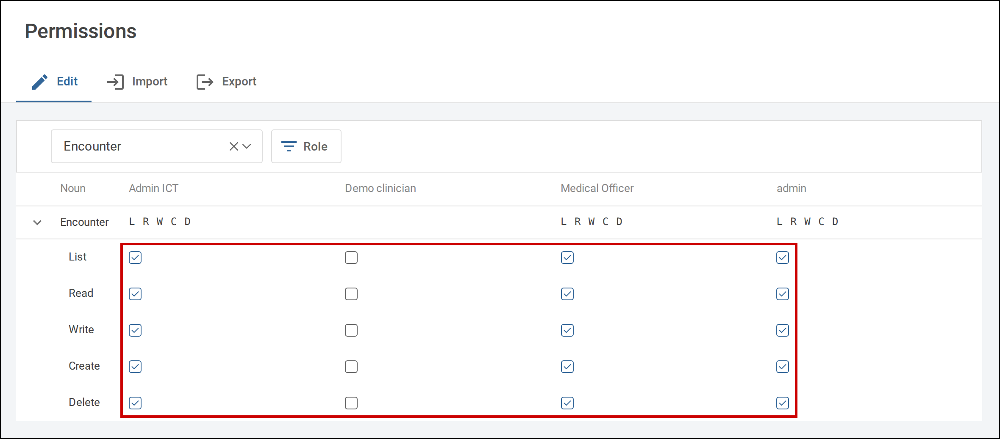
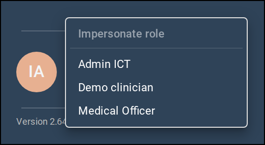

How access works in Tamanu, and what every permission grants. Access is role based: each user has one
role, and the role's permissions decide what its users can see and do on desktop, on mobile and in
the admin panel.

For setting up users and roles see [Reference data](01-reference-data.md),
and for the settings that decide which permissions apply see [Settings](02-settings.md).

---

# Permissions

## How permissions work

A permission is a **verb**, the action, applied to a **noun**, the part of Tamanu it acts on. For
example `create` for `LabRequest` lets a role raise lab requests, and `list` for `Patient` lets it
see the patient lists. Each noun accepts only some verbs; the reference below lists the verbs each
noun accepts and what each grants. The verbs themselves are listed under
[Permission verbs](#permission-verbs).

Many actions need several permissions together. Opening a patient's allergies, for example, needs
`read` for `Patient` as well as `list` for `PatientAllergy`. Where a permission depends on another,
the reference says so.

> [!CAUTION]
> Permissions granted through the permissions matrix only take effect once
> **Use hardcoded permissions** is turned off. See [Permissions source](02-settings.md#permissions-source).

Permissions sync to facility servers and mobile devices, so a change reaches staff once their device
has synced.

## Granting permissions

Permissions are granted to roles in the permissions matrix, either by importing it as a spreadsheet or
on the **Edit** tab of the **Permissions** screen in the admin panel.

### Permission verbs

Used in the `verb` column of the `Permission` tab. Input the value exactly as shown, in lower case.
Each noun accepts only some verbs, listed under the noun in the [Permission reference](#permission-reference).

| Value | Meaning |
| --- | --- |
| list | View a list of records |
| read | View the details of a record |
| write | Change an existing record |
| create | Add a new record |
| delete | Delete a record |
| run | Run a report |
| submit | Submit a form |
| login | Log in to a facility |
| sync | Sync, when **Restrict users to sync** is on. Not shown on the **Edit** tab of the **Permissions** screen. See [Sync restriction](02-settings.md#sync-restriction) |
| fhirIntegration | Connect an external system through an integration |

### Importing the permissions matrix

The permissions matrix is a spreadsheet with two tabs: `Role`, covered under
[Role](01-reference-data.md#role), and `Permission`, with one row per permission and one column per
role, marking which roles hold it. Both are imported on the **Import** tab of the **Permissions**
screen, and exported from its **Export** tab.

| Field | Value |
| --- | --- |
| Tab name | `Permission` |

Where * is a required field.

| Column name | Description |
| --- | --- |
| verb * | The action permitted, such as `read` or `write`. See [Permission verbs](#permission-verbs). This column is not validated on import, so a misspelt verb is accepted and grants nothing. |
| noun * | The part of Tamanu the action applies to, such as `Patient` or `LabRequest`. Must match a noun in the [Permission reference](#permission-reference) exactly, including case, or the row errors with `Noun is invalid or does not exist`. |
| objectId | Limits the permission to a single record, for the nouns that support it: a chart, form, report or program registry. Must be the id of an existing record, or the row errors with `Invalid objectId`. Leave blank to apply the permission to every record. See [Permissions for individual records](#permissions-for-individual-records). |

After these columns comes one column for each role, headed with the role's `id` from the `Role`
tab. Each cell takes:

- `y`: the role is granted the permission
- `n`: the permission is revoked from the role
- blank: no change. A blank cell does not revoke a permission the role already holds

Any other value errors. A column headed `note` is ignored, so it can carry comments on a row.

Roles granted the integration permissions used by external systems cannot also hold ordinary
permissions. An import that would give one role both errors. See
[Integrations](#integrations).

An export writes `y` for a granted permission and `n` for a revoked one, and leaves a cell blank where
the role has never held the permission, so an exported matrix re-imports unchanged. A role with no
permissions at all has no column in the export.

### Editing permissions in the admin panel

The **Edit** tab of the **Permissions** screen shows the matrix and lets permissions be turned on and
off directly. Turning a verb on also turns on the verbs below it, in the order `delete`, `create`,
`write`, `read`, `list`: turning on `create` for `Procedure` also grants `write`, `read` and `list`.
Turning a verb off turns off only that verb.

   
  Expand a noun to tick or untick each verb for each role.

Viewing the matrix needs `read` for `Permission` and `list` for `Role`. Turning permissions on needs
`create` for `Permission`, and turning them off needs `delete`. See [Permission](#permission).

The `sync` verb, and the nouns used only by integrations behind the scenes, are
not shown on the **Edit** tab, so they can only be granted through the import.

## Permissions for individual records

Four nouns can be granted for a single record rather than all of them, by entering the record's id in
the `objectId` column of the matrix:

| Noun | Record | Verbs that can be limited |
| --- | --- | --- |
| `Charting` | A chart | `list`, `read`, `write`, `create`, `delete` |
| `Survey` | A form or referral | `read`, `write`, `submit` |
| `ReportDefinition` | A report | `read`, `write`, `run` |
| `ProgramRegistry` | A program registry | `read`, `write` |

How each record's id is formed is set out under its noun below. The id must match an existing record
exactly, or the import errors with `Invalid objectId`.

> [!WARNING]
> A permission with no `objectId` applies to every record of that noun, and per-record permissions
> cannot narrow it. To restrict a role to some forms, charts, reports or registries, grant only the
> per-record permissions and leave out the general one.

A per-record permission also satisfies checks that are made against the noun as a whole. For example,
`read` for a single report opens the whole **Reports** screen in the admin panel, and `write` for a
single form, with `create`, lets a role import any program's forms. Where this happens it is noted
under the noun.

## The admin role

The role with the id `admin` is built in. Users with this role can do everything in Tamanu whatever
the matrix says, so editing the `admin` role's permissions has no effect. They are the users who can
change the settings marked high risk and set up a new facility server. They can also log in to every
facility, including sensitive ones, and are never restricted from syncing. See
[Facility access](02-settings.md#facility-access).

### Impersonating a role

A user with the `admin` role can see Tamanu desktop as another role would, to check a role's
permissions. Hold Ctrl (Cmd on a Mac) and select the user's avatar at the foot of the sidebar to open
**Impersonate role**, choose a role, and select **Stop impersonating** to return. Impersonation works
on desktop only.

   
  The <b>Impersonate role</b> list.

## Admin panel access

Any user who can log in can reach the admin panel; no permission is needed to open it, and facility
access does not apply. Each screen then checks its own permissions, and shows a permission message or
refuses the action where the role lacks them. Every item in the admin panel sidebar is shown to every
user, whatever their permissions.

Importing and exporting on the **Reference data** screen needs, for each data type selected:

- To import, `create` and `write` for the type's noun
- To export, `list` for the type's noun

Every type is selected by default, so a role that cannot import or export some types must deselect
them first. Types held in the general reference data list, such as `Village`, `Allergy`, `Drug` and
`Designation`, all use `ReferenceData`. Every other type uses its own noun, named after the type, such
as `Facility`, `Location` or `User`.

The **Manage** tab needs `list` for the type's noun to view records, `create` to add one and `write`
to edit one.

## Permissions and what staff see

Some buttons and menu items show to every user, and the action is refused only when it is saved.
The facility sidebar's **Labs**, **Imaging** and **Scheduling** items, for example, show to every user,
and the screen shows a permission message. Where a button shows without the permission it needs, the
reference says so.

Mobile checks fewer permissions than desktop. Where a permission is checked on mobile, the reference
says so.

---

# Permission reference

Nouns are grouped by the part of Tamanu they relate to. Where a verb is accepted for a noun but
granting it changes nothing for staff, it is listed as **Not currently checked** or **Has no effect on
any current screen**.

## Users and access

### `User`

User accounts, managed under **Users** > **User profiles** in the admin panel.

| Verb | What it grants |
| --- | --- |
| `list` | <ul><li>Open **User profiles** in the admin panel and see the list of users (without it the screen shows a permission message)</li><li>Choose clinicians in clinician fields across desktop</li><li>Export the user sheet in the admin panel</li></ul> |
| `read` | <ul><li>Show another user's name on desktop printouts, such as the prescriber on a prescription and the submitter on a printed form</li><li>See another user's upcoming leave on their profile in the admin panel</li></ul> |
| `write` | <ul><li>Change any user's profile in the admin panel, including changing their password, deactivating them (the **Status** field) and their **Allowed facilities**</li><li>Add and remove scheduled leave with **Schedule leave** and **Remove**</li><li>Import the user sheet in the admin panel (with `create`)</li></ul> |
| `create` | <ul><li>Add a user with **Add user** in the admin panel</li><li>Import the user sheet in the admin panel (with `write`)</li></ul> |

Every user can always see and update their own account, whatever their role; this does not let them edit their own profile in the admin panel. **Add user** and the profile also need `list` for `Role`, `ReferenceData` (designations) and `Facility` to fill their dropdowns. Sync accounts cannot be edited.

### `UserDesignation`

The link between users and their designations.

| Verb | What it grants |
| --- | --- |
| `list` | <ul><li>Not currently checked</li></ul> |
| `read` | <ul><li>Not currently checked</li></ul> |
| `write` | <ul><li>Not currently checked</li></ul> |
| `create` | <ul><li>Not currently checked</li></ul> |

Designations themselves are governed by `ReferenceData`, and assigning them to a user by `User`.

### `Role`

The roles users are assigned to.

| Verb | What it grants |
| --- | --- |
| `list` | <ul><li>See the **Roles** tab under **Users** > **Roles & designations** in the admin panel</li><li>See role columns and the **Role** filter in the **Permissions** matrix</li><li>Choose a role on **Add user** and on a user profile</li><li>Export the permissions spreadsheet (with `list` for `Permission`)</li></ul> |
| `read` | <ul><li>See the role in the **Delete role** dialog in the admin panel</li></ul> |
| `write` | <ul><li>Import the permissions spreadsheet (with `create`, and `create` and `write` for `Permission`)</li></ul> |
| `create` | <ul><li>Add a role with **Add role** in the admin panel</li><li>Import the permissions spreadsheet (as above)</li></ul> |
| `delete` | <ul><li>Delete a role in the admin panel, blocked while any user account (including deactivated ones) is assigned to it</li></ul> |

### `Permission`

The permissions held by each role, managed on the **Permissions** screen in the admin panel.

| Verb | What it grants |
| --- | --- |
| `list` | <ul><li>Export the permissions spreadsheet from the **Export** tab (with `list` for `Role`)</li></ul> |
| `read` | <ul><li>See the permissions matrix on the **Edit** tab (without it the tab shows a permission message)</li><li>Also requires `list` for `Role` to see any role columns</li></ul> |
| `write` | <ul><li>Import the permissions spreadsheet from the **Import** tab (with `create`, and `create` and `write` for `Role`)</li></ul> |
| `create` | <ul><li>Turn a permission on in the matrix</li><li>Import the permissions spreadsheet (with `write`, as above)</li></ul> |
| `delete` | <ul><li>Turn a permission off in the matrix</li></ul> |

Turning a verb on in the matrix also turns on the verbs below it in the order delete, create, write, read, list. Turning a verb off does not turn anything else off.

### `Facility`

The facilities in the deployment, and who may log in to them.

| Verb | What it grants |
| --- | --- |
| `list` | <ul><li>Choose a facility in facility fields across desktop and the admin panel, such as **Allowed facilities** on a user profile and the facility selector on **Location assignment** and **Asset upload**</li><li>Choose a facility in the **Settings** editor in the admin panel</li><li>Export the facility sheet, and see facilities on the **Reference data** > **Manage** tab, in the admin panel</li></ul> |
| `read` | <ul><li>See the current facility's name in the sidebar footer on desktop (without it the footer reads **Central admin server**)</li><li>Show facility details on printouts such as prescriptions, vaccine certificates, birth notifications and form responses, and on **Bed management** and medication dispensing screens</li></ul> |
| `write` | <ul><li>Edit a facility on the **Manage** tab in the admin panel</li><li>Import the facility sheet in the admin panel (with `create`)</li></ul> |
| `create` | <ul><li>Add a facility on the **Manage** tab in the admin panel</li><li>Import the facility sheet in the admin panel (with `write`)</li></ul> |
| `login` | <ul><li>When the **Restrict users to facilities** setting is on, log in to every facility that is not in a sensitive network, on desktop and on mobile</li><li>Has no effect while that setting is off, because everyone can then log in to every non-sensitive facility</li><li>Never grants a sensitive facility: those always have to be listed in the user's **Allowed facilities**</li></ul> |

## Administration

### `Setting`

The deployment's settings, edited on the **Settings** screen in the admin panel.

| Verb | What it grants |
| --- | --- |
| `list` | <ul><li>Not currently checked</li></ul> |
| `read` | <ul><li>See settings in the **Editor** tab of the **Settings** screen</li><li>Choose an AI model in the AI model fields of the editor</li></ul> |
| `write` | <ul><li>Save changes to settings</li><li>See the **JSON editor** tab</li><li>Changing high-risk settings and secret settings also needs the `admin` role</li></ul> |

Choosing a facility on the **Settings** screen also requires `list` for `Facility`.

### `Asset`

Images uploaded on the **Asset upload** screen in the admin panel, such as letterhead logos and certificate footers.

| Verb | What it grants |
| --- | --- |
| `list` | <ul><li>Not currently checked</li></ul> |
| `read` | <ul><li>Not currently checked</li></ul> |
| `write` | <ul><li>Replace an asset that has already been uploaded (for the same facility, or for all facilities) in the admin panel</li></ul> |
| `create` | <ul><li>Upload an asset that has not been uploaded before in the admin panel</li></ul> |

Choosing a facility on the **Asset upload** screen also requires `list` for `Facility`.

### `Template`

Patient letter templates and clinical note templates, managed on the **Templates** screen in the admin panel.

| Verb | What it grants |
| --- | --- |
| `list` | <ul><li>See the **Templates** screen in the admin panel</li><li>Choose a template when writing a patient letter or a note on desktop</li></ul> |
| `read` | <ul><li>Fill a patient letter or note from the chosen template on desktop</li></ul> |
| `write` | <ul><li>Edit a template, or remove it with **Delete template**, in the admin panel (with `read` and `list`)</li></ul> |
| `create` | <ul><li>Add a template in the admin panel (with `list`)</li></ul> |

### `PatientLetterTemplate`

An old noun for patient letter templates, replaced by `Template`.

| Verb | What it grants |
| --- | --- |
| `list` | <ul><li>Not currently checked</li></ul> |
| `read` | <ul><li>Not currently checked</li></ul> |
| `write` | <ul><li>Not currently checked</li></ul> |

### `Translation`

Editing translated text on the **Translation** screen in the admin panel.

| Verb | What it grants |
| --- | --- |
| `write` | <ul><li>Save changes on the **Edit** tab of the **Translation** screen</li></ul> |

Viewing the translations needs no permission. Importing and exporting translations is governed by `TranslatedString`.

### `TranslatedString`

The translated text itself, imported and exported on the **Translation** screen in the admin panel.

| Verb | What it grants |
| --- | --- |
| `list` | <ul><li>Export translations from the **Export** tab of the **Translation** screen</li></ul> |
| `read` | <ul><li>Not currently checked</li></ul> |
| `write` | <ul><li>Import translations from the **Import** tab (with `create`)</li></ul> |
| `create` | <ul><li>Import translations from the **Import** tab (with `write`)</li></ul> |

### `FormBuilder`

The AI form builder in the admin panel.

| Verb | What it grants |
| --- | --- |
| `write` | <ul><li>Use the **AI form builder** tab under **Programs** > **Programs & forms** in the admin panel to draft a form by chat</li><li>Also requires AI to be set up for the deployment</li></ul> |

Saving the drafted form into a program also requires `create` and `write` for `Survey`.

### `SensitiveNetwork`

Sensitive networks, which group facilities whose data is kept apart and whose access must be granted user by user.

| Verb | What it grants |
| --- | --- |
| `list` | <ul><li>Export the sensitive network sheet, and see networks on the **Reference data** > **Manage** tab, in the admin panel</li></ul> |
| `read` | <ul><li>Not currently checked</li></ul> |
| `write` | <ul><li>Edit a network on the **Manage** tab in the admin panel</li><li>Import the sheet in the admin panel (with `create`)</li></ul> |
| `create` | <ul><li>Add a network on the **Manage** tab in the admin panel</li><li>Import the sheet in the admin panel (with `write`)</li></ul> |

### `SyncPatient`

Marking a patient for sync, so their full record is kept on this facility or device.

| Verb | What it grants |
| --- | --- |
| `create` | <ul><li>See **Sync patient records** on a patient whose record is not yet synced to this facility, on desktop (also requires `read` for `Patient`)</li><li>Without it, desktop shows a message to contact the system administrator instead</li><li>Mark a patient for sync from the sync icon on the patient's screen, on mobile</li></ul> |

### `Kiosk`

The patient self check-in kiosk.

| Verb | What it grants |
| --- | --- |
| `run` | <ul><li>See **Self check-in kiosk** under **Facility admin** in the desktop sidebar (only shown when the kiosk is turned on in settings)</li><li>Run the kiosk on the account signed in to the tablet, so patients can find their appointment and check in</li><li>Without it the kiosk shows **Self check-in is unavailable**</li></ul> |

The kiosk account needs no other permission to run it.

### `Signer`

The keys used to sign vaccine certificates.

| Verb | What it grants |
| --- | --- |
| `list` | <ul><li>Not currently checked</li></ul> |
| `read` | <ul><li>Not currently checked</li></ul> |

## Reference data and locations

### `ReferenceData`

Values held in the general reference data list, such as allergies, villages, drugs, diagnoses and designations.

| Verb | What it grants |
| --- | --- |
| `list` | <ul><li>Choose values in reference data fields across desktop, such as allergy, village, diagnosis, drug and task fields</li><li>See the **Designations** tab under **Users** > **Roles & designations**, and choose designations on a user profile, in the admin panel</li><li>Export reference data sheets, and see these types on the **Reference data** > **Manage** tab, in the admin panel</li></ul> |
| `read` | <ul><li>Show reference data details on desktop, such as the patient's village on printed lab requests, prescriptions, encounter records and certificates, and the encounter's billing type</li><li>See a designation in the **Delete designation** dialog in the admin panel</li></ul> |
| `write` | <ul><li>Edit a value on the **Manage** tab in the admin panel</li><li>Import reference data sheets in the admin panel (with `create`)</li></ul> |
| `create` | <ul><li>Add a new value straight from a field on desktop where the field allows it, such as allergies and task reasons</li><li>Add a value on the **Manage** tab, and add a designation with **Add designation**, in the admin panel</li><li>Import reference data sheets in the admin panel (with `write`)</li></ul> |
| `delete` | <ul><li>Delete a designation in the admin panel, blocked while any user or task is assigned to it</li><li>No other reference data can be deleted</li></ul> |

### `ReferenceDataRelation`

Links between reference data records, such as the address hierarchy (village to subdivision) and facility catchments.

| Verb | What it grants |
| --- | --- |
| `list` | <ul><li>Export the relation sheet, and see relations on the **Reference data** > **Manage** tab, in the admin panel</li></ul> |
| `read` | <ul><li>Not currently checked</li></ul> |
| `write` | <ul><li>Edit a relation, or remove one with **Delete**, on the **Manage** tab in the admin panel</li><li>Import the relation sheet in the admin panel (with `create`)</li></ul> |
| `create` | <ul><li>Add a relation on the **Manage** tab in the admin panel</li><li>Import the relation sheet in the admin panel (with `write`)</li></ul> |

Choosing the linked records on the **Manage** tab also requires `list` for `ReferenceData`.

### `Department`

Departments within each facility.

| Verb | What it grants |
| --- | --- |
| `list` | <ul><li>Choose a department in department fields across desktop, such as when starting an encounter, requesting labs or imaging, or recording a procedure or vaccine</li><li>Choose a department in the **Settings** editor in the admin panel</li><li>Export the department sheet, and see departments on the **Reference data** > **Manage** tab, in the admin panel</li></ul> |
| `read` | <ul><li>Has no effect on any current screen</li></ul> |
| `write` | <ul><li>Edit a department on the **Manage** tab in the admin panel</li><li>Import the department sheet in the admin panel (with `create`)</li></ul> |
| `create` | <ul><li>Add a department on the **Manage** tab in the admin panel</li><li>Import the department sheet in the admin panel (with `write`)</li></ul> |

### `LocationGroup`

Areas (such as wards or clinics) within a facility, which group locations.

| Verb | What it grants |
| --- | --- |
| `list` | <ul><li>Choose an area in area fields and filters across desktop, such as **Bed management**, the emergency, lab, imaging and medication lists, patient search and appointment booking</li><li>Export the location group sheet, and see areas on the **Reference data** > **Manage** tab, in the admin panel</li></ul> |
| `read` | <ul><li>Open handover notes from **Bed management** on desktop (with the other permissions listed under `Location`)</li></ul> |
| `write` | <ul><li>Edit an area on the **Manage** tab in the admin panel</li><li>Import the location group sheet in the admin panel (with `create`)</li></ul> |
| `create` | <ul><li>Add an area on the **Manage** tab in the admin panel</li><li>Import the location group sheet in the admin panel (with `write`)</li></ul> |

The area list on the outpatient appointments calendar is controlled by `list` for `Location`, not `LocationGroup`.

### `Location`

Locations (such as beds or rooms) within an area of a facility.

| Verb | What it grants |
| --- | --- |
| `list` | <ul><li>Choose a location in location fields across desktop, such as moving a patient or booking a location</li><li>See the **Location bookings** calendar and the area list on the outpatient appointments calendar on desktop</li><li>Choose a location in the **Settings** editor and on the **Location assignment** screen in the admin panel</li><li>Export the location sheet, and see locations on the **Reference data** > **Manage** tab, in the admin panel</li></ul> |
| `read` | <ul><li>Open handover notes from **Bed management** on desktop (with `read` for `LocationGroup`, `Encounter` and `EncounterNote`, and `list` for `Patient`)</li></ul> |
| `write` | <ul><li>Edit a location on the **Manage** tab in the admin panel</li><li>Import the location sheet in the admin panel (with `create`)</li></ul> |
| `create` | <ul><li>Add a location on the **Manage** tab in the admin panel</li><li>Import the location sheet in the admin panel (with `write`)</li></ul> |

Moving a patient is governed by `write` for `Encounter`, not by `write` for `Location`.

### `LocationAssignment`

The clinicians assigned to each location, as scheduled in the admin panel.

| Verb | What it grants |
| --- | --- |
| `list` | <ul><li>See which clinicians are assigned to each location in the day view of **Location bookings** on desktop (either `list` or `read` is enough)</li></ul> |
| `read` | <ul><li>Same as `list`</li></ul> |

To create and change assignments, see `LocationSchedule`.

### `LocationSchedule`

Scheduling clinicians to locations on the **Location assignment** screen in the admin panel.

| Verb | What it grants |
| --- | --- |
| `list` | <ul><li>Open **Users** > **Location assignment** in the admin panel and see the assignment calendar (without it the screen shows a permission message)</li></ul> |
| `read` | <ul><li>Select an assignment on the calendar to see its details</li></ul> |
| `write` | <ul><li>Change an assignment with the **Edit** action in the assignment panel</li></ul> |
| `create` | <ul><li>Assign a user to a location with **Assign user**</li></ul> |
| `delete` | <ul><li>Remove an assignment with **Delete** in the assignment panel</li></ul> |

### `PatientFieldDefinitionCategory`

Categories that group custom patient fields.

| Verb | What it grants |
| --- | --- |
| `list` | <ul><li>Choose a category when adding or editing a patient field definition on the **Manage** tab in the admin panel</li><li>Export the sheet, and see categories on the **Manage** tab, in the admin panel</li></ul> |
| `read` | <ul><li>Not currently checked</li></ul> |
| `write` | <ul><li>Edit a category on the **Manage** tab in the admin panel</li><li>Import the sheet in the admin panel (with `create`)</li></ul> |
| `create` | <ul><li>Add a category on the **Manage** tab in the admin panel</li><li>Import the sheet in the admin panel (with `write`)</li></ul> |

### `PatientFieldDefinition`

Custom patient fields that a deployment adds to patient details.

| Verb | What it grants |
| --- | --- |
| `list` | <ul><li>Export the patient field definition sheet, and see definitions on the **Reference data** > **Manage** tab, in the admin panel</li></ul> |
| `read` | <ul><li>Not currently checked</li></ul> |
| `write` | <ul><li>Edit a definition on the **Manage** tab in the admin panel</li><li>Import the sheet in the admin panel (with `create`)</li></ul> |
| `create` | <ul><li>Add a definition on the **Manage** tab in the admin panel</li><li>Import the sheet in the admin panel (with `write`)</li></ul> |

Choosing a category on the **Manage** tab also requires `list` for `PatientFieldDefinitionCategory`. Seeing and filling in the fields on desktop is governed by `Patient`.

### `ScheduledVaccine`

The vaccine schedule: which vaccines are due, and when.

| Verb | What it grants |
| --- | --- |
| `list` | <ul><li>Export the scheduled vaccine sheet, and see scheduled vaccines on the **Reference data** > **Manage** tab, in the admin panel</li></ul> |
| `read` | <ul><li>Not currently checked</li></ul> |
| `write` | <ul><li>Edit a scheduled vaccine on the **Manage** tab in the admin panel</li><li>Import the sheet in the admin panel (with `create`)</li></ul> |
| `create` | <ul><li>Add a scheduled vaccine on the **Manage** tab in the admin panel</li><li>Import the sheet in the admin panel (with `write`)</li></ul> |

Choosing the vaccine on the **Manage** tab also requires `list` for `ReferenceData`. Seeing a patient's vaccine schedule on desktop is governed by `PatientVaccine`.

### `CertifiableVaccine`

The certifiable vaccine reference data, which says which vaccines can appear on vaccine certificates.

| Verb | What it grants |
| --- | --- |
| `list` | <ul><li>Export the certifiable vaccine sheet in the admin panel</li><li>See certifiable vaccines on the **Reference data** > **Manage** tab in the admin panel</li></ul> |
| `read` | <ul><li>Not currently checked</li></ul> |
| `write` | <ul><li>Edit a certifiable vaccine on the **Manage** tab in the admin panel</li><li>Import the certifiable vaccine sheet in the admin panel (with `create`)</li></ul> |
| `create` | <ul><li>Add a certifiable vaccine on the **Manage** tab in the admin panel</li><li>Import the certifiable vaccine sheet in the admin panel (with `write`)</li></ul> |

Choosing the vaccine on the **Manage** tab also requires `list` for `ReferenceData`.

### `ImagingAreaExternalCode`

Codes that map imaging areas to an external imaging system.

| Verb | What it grants |
| --- | --- |
| `list` | <ul><li>Export the imaging area external code sheet, and see the codes on the **Reference data** > **Manage** tab, in the admin panel</li></ul> |
| `read` | <ul><li>Not currently checked</li></ul> |
| `write` | <ul><li>Edit a code on the **Manage** tab in the admin panel</li><li>Import the sheet in the admin panel (with `create`)</li></ul> |
| `create` | <ul><li>Add a code on the **Manage** tab in the admin panel</li><li>Import the sheet in the admin panel (with `write`)</li></ul> |

### `ImagingTypeExternalCode`

Codes that map imaging types to an external imaging system.

| Verb | What it grants |
| --- | --- |
| `list` | <ul><li>Export the imaging type external code sheet, and see the codes on the **Reference data** > **Manage** tab, in the admin panel</li></ul> |
| `read` | <ul><li>Not currently checked</li></ul> |
| `write` | <ul><li>Edit a code on the **Manage** tab in the admin panel</li><li>Import the sheet in the admin panel (with `create`)</li></ul> |
| `create` | <ul><li>Add a code on the **Manage** tab in the admin panel</li><li>Import the sheet in the admin panel (with `write`)</li></ul> |

## Reports

### `ReportDefinition`

Database-defined reports: generating them on desktop, and managing them on the **Reports** screen in the admin panel.

| Verb | What it grants |
| --- | --- |
| `list` | <ul><li>Choose reports in report fields of the **Settings** editor in the admin panel, such as the DHIS2 **Reports** setting</li></ul> |
| `read` | <ul><li>Open the **Reports** screen in the admin panel, see reports and their versions, and export a version (with `read` for `ReportDefinitionVersion`)</li></ul> |
| `write` | <ul><li>Not currently checked</li></ul> |
| `create` | <ul><li>Create a report on the **Create** tab, save a new version from the editor, and import a report on the **Import** tab (with `create` for `ReportDefinitionVersion`)</li></ul> |
| `run` | <ul><li>See a report in the report list under **Facility admin** > **Reports** on desktop, and generate or email it</li><li>The **Generic Survey Export - Line List** report also needs `read` for `Survey` on the chosen form</li></ul> |

The objectId for `ReportDefinition` is the report's ID: the ID created when the report is first created or imported (shown as **Report id** after an import), or a fixed ID for built-in reports such as `generic-survey-export-line-list`. IDs created in the admin panel differ between deployments. The **Permissions** matrix lists one row per report, by name. A `run` permission with no objectId lets the role run every report, and makes per-report `run` rows irrelevant. A per-report `run` lets the role run only that report. The admin **Reports** screen checks report access as a whole, so a per-report `read` row opens it for every report, and a per-report `write` row does nothing.

### `ReportDefinitionVersion`

The versions of each database-defined report.

| Verb | What it grants |
| --- | --- |
| `list` | <ul><li>Not currently checked</li></ul> |
| `read` | <ul><li>Needed alongside `read` for `ReportDefinition` to use the **Reports** screen in the admin panel</li></ul> |
| `write` | <ul><li>Not currently checked</li></ul> |
| `create` | <ul><li>Needed alongside `create` for `ReportDefinition` to create, save or import reports in the admin panel</li></ul> |

### `ReportDbSchema`

Access to reports that query the raw database instead of the reporting schema.

| Verb | What it grants |
| --- | --- |
| `write` | <ul><li>See raw-database reports on the **Reports** screen in the admin panel (when the reporting schema is in use, other users only see reporting-schema reports)</li><li>See and change the **DB Schema** field when creating or editing a report</li><li>Import a report that uses the raw database</li></ul> |

### `ReportRequest`

Requests to generate a report and email it.

| Verb | What it grants |
| --- | --- |
| `list` | <ul><li>Not currently checked</li></ul> |
| `read` | <ul><li>Not currently checked</li></ul> |
| `write` | <ul><li>Not currently checked</li></ul> |
| `create` | <ul><li>Not currently checked</li></ul> |

Emailing a report is governed by `run` for `ReportDefinition`.

## Patients

### `Patient`

A patient record, and access to the patient screens built on it.

| Verb | What it grants |
| --- | --- |
| `list` | <ul><li>See and search the patient lists, including **All patients** and recently discharged patients</li><li>See **Recently viewed patients**</li><li>Search for a patient in any patient picker field</li><li>Use bed management, ward occupancy and readmission statistics, and handover notes (handover notes also need `read` for `Location` and `LocationGroup`)</li></ul> |
| `read` | <ul><li>Open a patient and see their details, including birth details, additional details, insurance plans and custom patient fields</li><li>Needed for almost every patient-level list: ongoing conditions, allergies, family history, other issues, care plans, forms, referrals, program registrations and secondary IDs</li><li>See the **Reminder contacts** button (also on mobile)</li><li>Mark a patient for sync to this facility (with `create` for `SyncPatient`)</li><li>In the admin panel, look up patients to merge on the **Patient merge** screen</li></ul> |
| `write` | <ul><li>Save changes on the patient **Details** tab, including birth details. Changing the display ID also saves the old ID as a secondary ID</li><li>Add and remove reminder contacts with **Add contact** and **Remove** (also on mobile)</li><li>Record or revert a death (with `create` for `PatientDeath`)</li><li>In the admin panel, merge two patients on the **Patient merge** screen</li></ul> |
| `create` | <ul><li>Use **Add new patient**, including recording birth details for a birth registration</li></ul> |

The **Details** tab opens if the role has any of `read`, `write` or `create`; without `write` the changes cannot be saved.

### `PatientAllergy`

An allergy recorded against a patient.

| Verb | What it grants |
| --- | --- |
| `list` | <ul><li>See the **Allergies** section in the patient sidebar</li></ul> |
| `read` | <ul><li>Needed alongside `write` to save changes to an existing allergy</li></ul> |
| `write` | <ul><li>Edit an existing allergy</li></ul> |
| `create` | <ul><li>**Add** an allergy</li></ul> |

Also requires `read` for `Patient`. Not checked on mobile.

### `PatientCondition`

An ongoing condition recorded against a patient.

| Verb | What it grants |
| --- | --- |
| `list` | <ul><li>See the **Ongoing conditions** section in the patient sidebar</li></ul> |
| `read` | <ul><li>Needed alongside `write` to save changes to an existing condition</li></ul> |
| `write` | <ul><li>Edit an existing condition, including marking it resolved</li></ul> |
| `create` | <ul><li>**Add** an ongoing condition</li></ul> |
| `delete` | <ul><li>**Delete** an ongoing condition</li></ul> |

Also requires `read` for `Patient`. Not checked on mobile.

### `PatientFamilyHistory`

A family history condition recorded against a patient.

| Verb | What it grants |
| --- | --- |
| `list` | <ul><li>See the **Family history** section in the patient sidebar</li></ul> |
| `read` | <ul><li>Needed alongside `write` to save changes to an existing family history item</li></ul> |
| `write` | <ul><li>Edit an existing family history item</li></ul> |
| `create` | <ul><li>**Add** a family history item</li></ul> |

Also requires `read` for `Patient`. Not checked on mobile.

### `PatientIssue`

An issue or warning recorded against a patient, other than an ongoing condition.

| Verb | What it grants |
| --- | --- |
| `list` | <ul><li>See the **Other patient issues** section in the patient sidebar</li></ul> |
| `read` | <ul><li>Needed alongside `write` to save changes to an existing issue</li></ul> |
| `write` | <ul><li>Edit an existing patient issue</li></ul> |
| `create` | <ul><li>**Add** a patient issue</li></ul> |

Also requires `read` for `Patient`. Not checked on mobile.

### `PatientCarePlan`

A care plan recorded against a patient, and its notes.

| Verb | What it grants |
| --- | --- |
| `list` | <ul><li>See the **Care plans** section in the patient sidebar</li></ul> |
| `read` | <ul><li>Open a care plan and see its notes</li></ul> |
| `write` | <ul><li>**Edit** or **Delete** a note on a care plan</li></ul> |
| `create` | <ul><li>**Add** a care plan (**Add care plan**)</li><li>**Add note** to an existing care plan</li></ul> |

Also requires `read` for `Patient`. Not checked on mobile.

### `PatientBirthData`

A patient's birth details (birth registry fields).

| Verb | What it grants |
| --- | --- |
| `read` | <ul><li>Not currently checked</li></ul> |
| `write` | <ul><li>Not currently checked</li></ul> |

Birth details are seen with `read` for `Patient`, saved with `write` for `Patient`, and created with `create` for `Patient`.

### `PatientDeath`

Recording a patient's death.

| Verb | What it grants |
| --- | --- |
| `read` | <ul><li>See the death details on a deceased patient's summary and open the **Death certificate**</li><li>See **Revert death record** for a deceased patient (with `create`)</li></ul> |
| `create` | <ul><li>**Record death**, and complete the **Cause of death** details</li><li>**Revert death record** while the death record is not final</li></ul> |

Also requires `write` for `Patient` to record or revert a death, and the **Record death** actions only show when the patient deaths feature is enabled.

### `PatientDeathData`

The recorded details of a patient's death.

| Verb | What it grants |
| --- | --- |
| `read` | <ul><li>Not currently checked</li></ul> |
| `write` | <ul><li>Not currently checked</li></ul> |

Death details are viewed with `read` for `PatientDeath`.

### `PatientSecondaryId`

A patient's secondary identifiers, such as a previous display ID.

| Verb | What it grants |
| --- | --- |
| `list` | <ul><li>Not currently checked</li></ul> |
| `read` | <ul><li>Has no effect on any current screen</li></ul> |
| `write` | <ul><li>Has no effect on any current screen</li></ul> |
| `create` | <ul><li>Has no effect on any current screen</li></ul> |

Secondary IDs are created automatically, under `write` for `Patient`, when a patient's display ID is changed.

### `PatientSummary`

The AI-generated patient summary.

| Verb | What it grants |
| --- | --- |
| `read` | <ul><li>See the **AI patient summary** panel in the patient sidebar (with `write`)</li></ul> |
| `write` | <ul><li>See the **AI patient summary** panel (with `read`)</li><li>Edit and **Save** the summary, or **Discard** it</li></ul> |
| `create` | <ul><li>Generate the summary, including **Regenerate AI summary** and the automatic generation when a summary is missing or out of date</li></ul> |

The panel only shows when the patient summary setting is enabled and the patient is marked for sync to this facility.

### `PatientPortalRegistration`

Registering a patient for the patient portal.

| Verb | What it grants |
| --- | --- |
| `read` | <ul><li>Has no effect on any current screen</li></ul> |
| `create` | <ul><li>Use **Patient portal registration** under **Patient resources** to email the patient a registration link</li><li>Send a portal form to a patient who has no portal account yet</li></ul> |

These only show when the patient portal feature is enabled.

### `PatientPortalForm`

Forms sent to a patient through the patient portal.

| Verb | What it grants |
| --- | --- |
| `list` | <ul><li>See the **Outstanding patient program forms** table on the patient **Forms** tab</li></ul> |
| `read` | <ul><li>Not currently checked</li></ul> |
| `create` | <ul><li>**Send to patient portal** when choosing a form</li><li>Also needs `create` for `PatientPortalRegistration` if the patient has no portal account yet</li></ul> |
| `delete` | <ul><li>**Delete** an outstanding portal form</li></ul> |

These only show when the patient portal feature is enabled. Choosing a form also needs the `Program` and `Survey` permissions for that form.

## Programs, forms and registries

### `Program`

A program, which groups forms (surveys) and referrals.

| Verb | What it grants |
| --- | --- |
| `list` | <ul><li>See the program list when starting a **New form**. Only programs with at least one form the role can `submit` are listed</li><li>In the admin panel, see programs on the **Programs & forms** screen and export a program from the **Export** tab</li></ul> |
| `read` | <ul><li>Load a program's forms when starting a **New form**</li><li>In the admin panel, open a program on the **Manage** tab</li></ul> |
| `write` | <ul><li>In the admin panel, **Edit program metadata**</li><li>Import programs from the **Import** tab (with `create`)</li></ul> |
| `create` | <ul><li>Import programs from the **Import** tab (with `write`). This also imports any program registry, statuses and conditions in the file</li></ul> |

### `Survey`

A form (survey), including program forms and referral forms.

| Verb | What it grants |
| --- | --- |
| `list` | <ul><li>See the list of forms to choose from when starting a **New form**, a referral or a procedure form</li><li>Choose a form in report parameters</li><li>In the admin panel, see a program's forms on the **Manage** tab</li></ul> |
| `read` | <ul><li>Open a form to fill it in</li><li>See a form's submitted responses in the patient and encounter **Forms** tabs and the **Referrals** tab, and open, print or view the **Change log** of a response</li><li>On mobile, see a form's past responses and referrals</li><li>Run the **Generic Survey Export - Line List** report for that form</li></ul> |
| `write` | <ul><li>**Edit** a submitted program form response (with `read` for `SurveyResponse`)</li><li>In the admin panel, **Edit form metadata**, **Make historical** or **Make current**</li><li>Import forms from the **Import** tab or save forms from the **AI form builder** (with `create`)</li></ul> |
| `create` | <ul><li>Import forms from the **Import** tab or save forms from the **AI form builder** (with `write`)</li></ul> |
| `submit` | <ul><li>Have the form offered in the list when starting a **New form**, a referral or a procedure form, on desktop and mobile</li></ul> |

To fill in a form on desktop a role needs `list` and `read` for `Program`, `list` for `Survey`, `read` and `submit` for that form, and `create` for `SurveyResponse`. Mobile checks only `submit`.

The objectId is the form's id: `program-`, the program code, a hyphen, then the form code. Both codes come from the program import file's Metadata sheet, and both are lower-cased with every character other than letters, digits and underscores removed, so program code `DER-Assessment` and form code `Refraction` give `program-derassessment-refraction`. A form saved from the **AI form builder** follows the same pattern, with a number added to the form code if it is already taken. `read`, `write` and `submit` can be granted per form. A grant with no objectId covers every form, and per-form grants cannot narrow it. A per-form grant also passes any check that does not name a form, so a role with `write` on one form and `create` can import any program's forms.

### `SurveyResponse`

A submitted form response.

| Verb | What it grants |
| --- | --- |
| `list` | <ul><li>See submitted forms in the patient and encounter **Forms** tabs and referrals in the **Referrals** tab, limited to forms the role can `read`</li></ul> |
| `read` | <ul><li>Open a submitted response, and view its **Change log**</li><li>Needed to **Edit** a response (with `write` for that `Survey`)</li><li>Let a form fill in answers from the patient's earlier responses</li></ul> |
| `write` | <ul><li>Not currently checked</li></ul> |
| `create` | <ul><li>Submit a program form or a procedure form</li><li>In the admin panel, import responses on the **Survey responses** screen</li></ul> |
| `delete` | <ul><li>**Delete** a submitted form response</li></ul> |

Also requires `read` for the form's `Survey` to open, edit or view the change log of a response. Referrals are submitted under `create` for `Referral`, vitals under `Vitals` and charts under `Charting`. Not checked on mobile.

### `Referral`

Referrals made from a patient's **Referrals** tab.

| Verb | What it grants |
| --- | --- |
| `list` | <ul><li>Checked only for an encounter's own referral list, which no current desktop screen uses. The **Referrals** tab list needs `list` for `SurveyResponse` and `read` for each referral form's `Survey`</li></ul> |
| `read` | <ul><li>Needed, with `write`, to change a referral's status</li></ul> |
| `write` | <ul><li>**Complete** or **Cancel** a pending referral</li><li>**Admit** a patient from a pending referral (with `create` for `Encounter`)</li></ul> |
| `create` | <ul><li>Submit a **New referral** (also requires `list` and `submit` for `Survey`, and `read` for the referral form's `Survey`)</li></ul> |
| `delete` | <ul><li>**Delete** a referral from its actions menu</li></ul> |

Viewing and printing a referral is controlled by the `Survey` and `SurveyResponse` permissions, not this noun.

### `ProgramRegistry`

A program registry.

| Verb | What it grants |
| --- | --- |
| `list` | <ul><li>See the **Program Registry** section in the sidebar, listing every current registry</li><li>Choose a registry when adding a patient to one</li><li>See the charts linked to a registry</li><li>In the admin panel, see the **Program registries** list</li></ul> |
| `read` | <ul><li>Open a registry's page and see its patients</li><li>Open a patient's registry page, status history, related conditions and forms</li><li>On mobile, see the registry in the patient's registrations, the add form and the patient search filter</li><li>In the admin panel, open a registry</li></ul> |
| `write` | <ul><li>In the admin panel, **Edit program registry metadata**, including making a registry historical or current</li></ul> |

The objectId is the registry's id: `programRegistry-` followed by the `registryCode` from the program import file's Registry sheet, exactly as written there. The code is not lower-cased, so `registryCode` `HIV` gives `programRegistry-HIV`. `read` and `write` can be granted per registry. A grant with no objectId covers every registry, and per-registry grants cannot narrow it. `list` cannot be granted per registry, so the desktop sidebar lists every registry to a role with `list`, even ones it cannot `read`; opening one of those fails. Mobile hides registries the role cannot `read`.

### `ProgramRegistryClinicalStatus`

A clinical status a program registry can assign to a patient.

| Verb | What it grants |
| --- | --- |
| `list` | <ul><li>Choose a **Status** when adding or updating a registration, and filter a registry's patients by status</li><li>In the admin panel, see the **Statuses** tab of a program registry</li></ul> |
| `read` | <ul><li>In the admin panel, needed alongside `write` to edit a status</li></ul> |
| `write` | <ul><li>In the admin panel, edit a status, or make it historical or current</li></ul> |

New statuses come from importing the program (`create` and `write` for `Program`).

### `ProgramRegistryCondition`

A condition a program registry tracks.

| Verb | What it grants |
| --- | --- |
| `list` | <ul><li>Choose related conditions when adding or updating a registration, and filter a registry's patients by condition</li><li>In the admin panel, see the **Related conditions** tab of a program registry</li></ul> |
| `read` | <ul><li>In the admin panel, needed alongside `write` to edit a condition</li></ul> |
| `write` | <ul><li>In the admin panel, edit a condition, or make it historical or current</li></ul> |

New conditions come from importing the program (`create` and `write` for `Program`).

### `ProgramRegistryConditionCategory`

A category for a registry's related conditions, such as confirmed or recorded in error.

| Verb | What it grants |
| --- | --- |
| `list` | <ul><li>Choose a **Category** for a related condition</li><li>In the admin panel, see the **Related condition categories** tab of a program registry</li></ul> |
| `read` | <ul><li>In the admin panel, needed alongside `write` to edit a category</li></ul> |
| `write` | <ul><li>In the admin panel, edit a category, or make it historical or current</li></ul> |

### `PatientProgramRegistration`

A patient's registration in a program registry.

| Verb | What it grants |
| --- | --- |
| `list` | <ul><li>See the **Program registry** section in the patient sidebar (with `read`)</li><li>See the patients on a program registry's page</li><li>See a registration's status history</li><li>On mobile, see the **Program registries** menu item (`list` or `create`) and the patient's registrations</li></ul> |
| `read` | <ul><li>Open a patient's registry page from the patient sidebar</li><li>On mobile, open a registration, and let forms show the patient's registration details</li></ul> |
| `write` | <ul><li>**Update** a registration's status and related conditions</li><li>**Remove** a patient from a registry, or **Activate** a removed registration</li></ul> |
| `create` | <ul><li>**Add** a patient to a registry (**Add program registry**)</li><li>On mobile, use the add button in the **Program registry** section</li></ul> |
| `delete` | <ul><li>**Delete** a registration (marks it recorded in error and removes its related conditions)</li></ul> |

Also requires `read` for `Patient` and `read` for `ProgramRegistry` on that registry, except for **Update**, **Remove**, **Activate** and **Delete**, which do not check the registry.

### `PatientProgramRegistrationCondition`

A related condition recorded on a patient's program registration.

| Verb | What it grants |
| --- | --- |
| `list` | <ul><li>See the **Related conditions** on a patient's registry page</li></ul> |
| `read` | <ul><li>Needed alongside `write` to change a related condition</li></ul> |
| `write` | <ul><li>**Update condition**: change a related condition's category, including to recorded in error</li></ul> |
| `create` | <ul><li>Add related conditions when adding a patient to a registry or using **Update**</li></ul> |
| `delete` | <ul><li>Not currently checked</li></ul> |

Also requires `read` for `ProgramRegistry` on that registry to see the list.

## Encounters

### `Encounter`

A patient's visit to a facility, and the screens and actions inside it.

| Verb | What it grants |
| --- | --- |
| `list` | <ul><li>See a patient's encounter history on their **Summary** tab</li><li>See the document list on a patient's **Documents** tab (with `list` for `DocumentMetadata`)</li><li>Choose an encounter in **Link encounter** when booking a location</li></ul> |
| `read` | <ul><li>Open an encounter from the encounter history, or with **View encounter** on the current one</li><li>Use any tab inside an encounter (every tab needs it, alongside the tab's own permission)</li><li>See **Handover notes** in bed management (with other permissions)</li></ul> |
| `write` | <ul><li>**Edit encounter details**, **Move patient**, **Finalise** or **Cancel** a planned move, and add an **Estimated discharge date**</li><li>Change the encounter type (**Admit to hospital**, **Transfer to Active ED care**, **Transfer to Emergency short stay**)</li><li>**Prepare discharge** and **Prepare discharge without being seen** (finalising needs `write` for `Discharge` as well)</li><li>Send an encounter's medications to pharmacy (with medication permissions)</li></ul> |
| `create` | <ul><li>**Admit or check in** a patient</li><li>**Admit or check in** from an appointment (with `write` for `Appointment`)</li><li>Send a patient's ongoing medications to pharmacy when they have no open encounter, which creates one</li></ul> |
| `delete` | <ul><li>**Delete** an encounter from the actions menu in the encounter history</li></ul> |

### `Triage`

Emergency department triage records.

| Verb | What it grants |
| --- | --- |
| `list` | <ul><li>See the **Emergency patients** list</li><li>See the triage score and complaints on an emergency encounter</li></ul> |
| `read` | <ul><li>Needed, with `write`, to save changes to triage details</li></ul> |
| `write` | <ul><li>Change arrival time, triage score and complaints in **Edit encounter details** on an emergency encounter</li></ul> |
| `create` | <ul><li>Admit a patient as a **Triage** encounter (the **Admit or check in** button needs `create` for `Encounter` as well)</li><li>Recording vitals in the triage form also requires `create` for `Vitals`</li></ul> |

### `EncounterDiagnosis`

Diagnoses recorded on an encounter.

| Verb | What it grants |
| --- | --- |
| `list` | <ul><li>See an encounter's diagnoses; without it the encounter shows "You do not have permission to list diagnoses"</li></ul> |
| `read` | <ul><li>Needed, with `write`, to save changes to a diagnosis</li></ul> |
| `write` | <ul><li>Edit a diagnosis, including setting its certainty to **Recorded in error** to remove it</li></ul> |
| `create` | <ul><li>**Add diagnosis**</li></ul> |

### `EncounterNote`

Notes on an encounter's **Notes** tab.

| Verb | What it grants |
| --- | --- |
| `list` | <ul><li>See notes on the **Notes** tab, including a note's edit history</li><li>See notes in the encounter record printout</li></ul> |
| `read` | <ul><li>See **Handover notes** in bed management (with other permissions)</li></ul> |
| `write` | <ul><li>See the edit icon on a note. Saving the edit is checked against `create`, so editing needs both</li></ul> |
| `create` | <ul><li>**New note**</li><li>Save an edit to a note</li></ul> |

Editing a note written by someone else also needs `OtherPractitionerEncounterNote`, or `TreatmentPlanNote` for a treatment plan.

### `OtherPractitionerEncounterNote`

Editing encounter notes written by other people.

| Verb | What it grants |
| --- | --- |
| `write` | <ul><li>Edit another user's encounter note, other than a treatment plan</li><li>Also requires `create` and `write` for `EncounterNote`</li></ul> |

Without it, a user can still edit notes they wrote. Treatment plans written by others are controlled by `TreatmentPlanNote`.

### `TreatmentPlanNote`

Editing treatment plan notes written by other people.

| Verb | What it grants |
| --- | --- |
| `write` | <ul><li>Edit a treatment plan note written by another user</li><li>Also requires `create` and `write` for `EncounterNote`</li></ul> |

Without it, a user can still edit treatment plans they wrote.

### `TreatmentPlan`

An unused noun: treatment plan notes are controlled by `TreatmentPlanNote` and `EncounterNote`.

| Verb | What it grants |
| --- | --- |
| `read` | <ul><li>Not currently checked</li></ul> |
| `write` | <ul><li>Not currently checked</li></ul> |

### `Vitals`

Vital signs recorded on an encounter's **Vitals** tab.

| Verb | What it grants |
| --- | --- |
| `list` | <ul><li>See recorded vitals and vitals graphs on the **Vitals** tab (needs `read` as well)</li></ul> |
| `read` | <ul><li>Needed, with `list`, to see recorded vitals</li><li>Open the **Record vitals** form (needs `create` as well)</li></ul> |
| `write` | <ul><li>Edit or clear a recorded vital value (when vitals editing is turned on in settings)</li></ul> |
| `create` | <ul><li>**Record vitals**; without it the form shows "Permission required"</li><li>Add a missing value to recorded vitals (when vitals editing is turned on in settings)</li><li>Record vitals in the triage form</li></ul> |

### `Charting`

Charts recorded on an encounter's **Charts** tab and on a patient's program registry record, controllable per chart.

| Verb | What it grants |
| --- | --- |
| `list` | <ul><li>See the content of the **Charts** tab (a `list` on any one chart is enough)</li><li>See a chart in the chart type list</li><li>See the instances of a complex chart in an encounter (needs `list` on the complex chart's core)</li></ul> |
| `read` | <ul><li>View a chart's recorded entries and graphs</li><li>Select a recorded value to see its edit history</li><li>See the instances of a complex chart on a patient's program registry record (needs `read` on the core)</li></ul> |
| `write` | <ul><li>Edit or clear a recorded chart value (when chart editing is turned on in settings)</li><li>**Edit** a complex chart instance's details (needs `write` on the core)</li></ul> |
| `create` | <ul><li>**Record** a chart entry</li><li>Add a value to an existing entry (when chart editing is turned on in settings)</li><li>Add a new complex chart instance with the add button beside the chart list (needs `create` on the core)</li></ul> |
| `delete` | <ul><li>**Delete** a complex chart instance (needs `delete` on the core)</li><li>**Delete** a photo recorded in a chart</li></ul> |

The objectId is the chart's form id: `program-` followed by the program code and the chart code from the chart import file's **Metadata** tab, separated by hyphens, for example `program-woundassessment-woundassessment`. Both codes are lower-cased, and any character other than a letter, number or underscore is removed. A complex chart has two ids, one for the chart and one for its core (for example `program-woundassessment-woundassessmentcore`); instances are controlled by the core's id and entries by the chart's id, so a role usually needs both. A `Charting` permission with no objectId applies to every chart, and per-chart permissions cannot narrow it: per-chart rows only add charts to a role that lacks the general permission.

### `Procedure`

Procedures recorded on an encounter.

| Verb | What it grants |
| --- | --- |
| `list` | <ul><li>See procedures on the **Procedures** tab</li><li>See procedures in the discharge summary and the encounter record printout</li></ul> |
| `read` | <ul><li>Checked only when a single procedure is fetched on its own, which no current desktop screen does</li></ul> |
| `write` | <ul><li>Not currently checked. Editing a procedure is controlled by `create`</li></ul> |
| `create` | <ul><li>**New procedure**</li><li>Edit an existing procedure</li><li>Record a procedure's additional forms (also requires `create` for `SurveyResponse`)</li></ul> |
| `delete` | <ul><li>**Delete** a procedure from its actions menu</li></ul> |

### `Discharge`

Discharging a patient, and the discharge record of a past encounter.

| Verb | What it grants |
| --- | --- |
| `list` | <ul><li>Not currently checked</li></ul> |
| `read` | <ul><li>See the **Encounter record** and **Discharge summary** buttons on a discharged encounter, and open the discharge summary</li><li>See discharge details in the encounter record printout</li></ul> |
| `write` | <ul><li>Finalise a discharge from **Prepare discharge** (the button itself needs `write` for `Encounter`; without this permission the discharge fails when submitted)</li></ul> |
| `create` | <ul><li>Not currently checked</li></ul> |

### `EncounterSummary`

AI-generated encounter summaries in the discharge workflow.

| Verb | What it grants |
| --- | --- |
| `read` | <ul><li>See a saved AI summary in the discharge form and in the **Encounter record** printout</li></ul> |
| `write` | <ul><li>Edit or **Discard** an AI summary</li><li>Needed, with `create`, for the **Encounter summary** section to appear in the discharge form</li></ul> |
| `create` | <ul><li>**Generate AI summary**</li><li>Needed, with `write`, for the **Encounter summary** section to appear in the discharge form</li></ul> |

The section also only appears when the encounter summary feature is turned on in settings.

### `Tasking`

Tasks in the tasking module.

| Verb | What it grants |
| --- | --- |
| `list` | <ul><li>See an encounter's **Tasks** tab (when tasking is turned on in settings)</li></ul> |
| `read` | <ul><li>See **Upcoming tasks** on the **Dashboard** (when tasking is turned on in settings)</li></ul> |
| `write` | <ul><li>**Mark as complete**, **Mark as not complete** and **Mark as to-do**, for one task or several at once</li></ul> |
| `create` | <ul><li>**+ New task**</li></ul> |
| `delete` | <ul><li>**Delete** a to-do task, for one task or several at once</li></ul> |

### `DocumentMetadata`

Documents uploaded against a patient or encounter, and patient letters.

| Verb | What it grants |
| --- | --- |
| `list` | <ul><li>See the document list on a patient's **Documents** tab (needs `list` for `Encounter` as well)</li><li>See the document list on an encounter's **Documents** tab</li></ul> |
| `read` | <ul><li>Not currently checked</li></ul> |
| `write` | <ul><li>Save an upload from **Add document** (the button needs `create` as well)</li></ul> |
| `create` | <ul><li>Turns on the **Add document** button; saving the upload needs `write`</li><li>Create a **Patient letter**</li></ul> |
| `delete` | <ul><li>**Delete** a document from its actions menu</li></ul> |

Previewing, downloading or printing a document needs `read` for `Attachment`.

### `Attachment`

The stored files behind uploaded documents, patient letters and photos.

| Verb | What it grants |
| --- | --- |
| `list` | <ul><li>Not currently checked</li></ul> |
| `read` | <ul><li>Preview, download or print a document from the **Documents** tab</li><li>View a photo recorded in a form or chart</li></ul> |
| `create` | <ul><li>Not checked against the staff member's role. A desktop upload is checked against the facility server's own account on the central server</li></ul> |

### `Appointment`

Outpatient appointments and location bookings in the Scheduling module.

| Verb | What it grants |
| --- | --- |
| `list` | <ul><li>Open the **Outpatient appointments** and **Location bookings** screens (`list` or `read` is enough; with neither, the screen says you do not have permission)</li><li>See a patient's location bookings and outpatient appointments on their **Summary** tab (`list` or `read` is enough)</li><li>See appointments and bookings on the **Dashboard** (needs `read` as well)</li></ul> |
| `read` | <ul><li>Same screens as `list`: either verb opens them</li><li>See appointments and bookings on the **Dashboard** (needs `list` as well)</li></ul> |
| `write` | <ul><li>**Modify** or **Cancel** an appointment or booking, and change its status from its details</li><li>**Cancel** from the actions menu in a patient's appointment and booking tables</li><li>**Admit or check in** from an appointment's details (needs `create` for `Encounter` as well)</li></ul> |
| `create` | <ul><li>**Book appointment** and **Book location**, or select an empty calendar slot to book</li><li>**Book appointment** from a patient's **Summary** tab</li><li>Send a booking by email (**Email booking**)</li></ul> |

## Immunisations

### `PatientVaccine`

Vaccinations recorded against a patient.

| Verb | What it grants |
| --- | --- |
| `list` | <ul><li>See a patient's vaccine schedule and recorded vaccines on the **Vaccines** tab</li><li>Choose a vaccine when recording one</li><li>See vaccines on immunisation certificates</li><li>Needed, with `read`, to see the **Immunisation register**</li></ul> |
| `read` | <ul><li>Needed, with `list`, to see the **Immunisation register**</li><li>See the circumstances on a recorded vaccine's **View** window</li><li>Choose vaccines in a report's vaccine filter</li><li>Needed, with `write`, to edit or delete a recorded vaccine</li></ul> |
| `write` | <ul><li>**Edit** a recorded vaccine</li><li>**Delete** a recorded vaccine (marks it as recorded in error)</li></ul> |
| `create` | <ul><li>**Record vaccine**, or **Record** from the vaccine schedule</li></ul> |

### `AdministeredVaccine`

Bulk import and export of patients' vaccination records in the admin panel.

| Verb | What it grants |
| --- | --- |
| `list` | <ul><li>Export administered vaccines from **Patient data** in the admin panel</li></ul> |
| `read` | <ul><li>Not currently checked</li></ul> |
| `write` | <ul><li>Import administered vaccines through **Patient data** in the admin panel (needs `create` as well)</li></ul> |
| `create` | <ul><li>Import administered vaccines through **Patient data** in the admin panel (needs `write` as well)</li></ul> |

Recording, editing and viewing vaccines on a patient is controlled by `PatientVaccine`, not this noun.

### `CertificateNotification`

Emailing a certificate to a patient.

| Verb | What it grants |
| --- | --- |
| `create` | <ul><li>**Email** a certificate from the **Immunisation Certificate** or **COVID-19 Vaccine Certificate** window on the **Vaccines** tab, or from **Test certificate - COVID-19** or **Clearance certificate - COVID-19** in **Patient resources**</li><li>Not needed to view or print a certificate</li></ul> |

### `IPSRequest`

Emailing a patient their International Patient Summary (IPS) QR code.

| Verb | What it grants |
| --- | --- |
| `read` | <ul><li>Not currently checked</li></ul> |
| `create` | <ul><li>See **International Patient Summary** in **Patient resources** and email the QR code</li></ul> |

Also requires `read` for `Patient`.

## Labs

### `LabRequest`

Lab requests raised in an encounter.

| Verb | What it grants |
| --- | --- |
| `list` | <ul><li>See lab requests on the encounter **Labs** tab</li><li>See and search the **Labs** lists (**Active requests** and **Finalised**)</li><li>The **Labs** menu appears for everyone; without this permission its lists show a no-permission message</li></ul> |
| `read` | <ul><li>Open a lab request and view its details, notes and tests</li><li>**Print** lab requests from the encounter **Labs** tab</li><li>Also needed to enter results (see `LabTest`)</li></ul> |
| `write` | <ul><li>**Record sample**, **Edit** and **View details** of the sample</li><li>**Change laboratory** and **Change priority** (priority only where the facility allows it)</li><li>**Add note** to a lab request</li><li>**Cancel request** (also needs `write` for `LabRequestStatus`)</li><li>Also requires `read` for `LabRequest`</li></ul> |
| `create` | <ul><li>**New lab request** on the encounter **Labs** tab</li><li>Also requires `list` for `LabTestType` to choose individual tests, or `list` for `LabTestPanel` to choose panels</li></ul> |

### `LabRequestStatus`

Changes to the status of a lab request.

| Verb | What it grants |
| --- | --- |
| `write` | <ul><li>**Change status** on a lab request</li><li>**Record sample** for a request whose sample was not yet collected, which moves it on to reception pending</li><li>**Cancel request**</li><li>Also requires `write` for `LabRequest`</li></ul> |

### `LabRequestLog`

The history of status changes on a lab request.

| Verb | What it grants |
| --- | --- |
| `list` | <ul><li>**View status log** on a lab request</li><li>Show who published the results on the printed lab results report</li></ul> |
| `read` | <ul><li>Not currently checked</li></ul> |
| `write` | <ul><li>Not currently checked</li></ul> |
| `create` | <ul><li>Not currently checked</li></ul> |

### `LabTest`

The individual tests on a lab request, and the details recorded against them.

| Verb | What it grants |
| --- | --- |
| `list` | <ul><li>See the tests on a lab request, including on its printed request and results</li><li>See lab results on the patient **Results** tab (also needs `read` for `LabTestResult`)</li></ul> |
| `read` | <ul><li>Open a single lab result from the patient **Results** tab, with its result history</li></ul> |
| `write` | <ul><li>**Enter results** on a lab request: test method, verification and completed date</li><li>Also requires `read` for `LabRequest`. Changing the result values themselves also needs `write` for `LabTestResult`</li></ul> |
| `create` | <ul><li>Not currently checked</li></ul> |

### `LabTestResult`

The results recorded for lab tests.

| Verb | What it grants |
| --- | --- |
| `list` | <ul><li>Not currently checked</li></ul> |
| `read` | <ul><li>See the patient **Results** tab (also needs `list` for `LabTest`)</li><li>**Print results** and **Print interim report** on a lab request, where lab results printouts are turned on</li><li>See the result history when opening a single lab result (also needs `read` for `LabTest`)</li></ul> |
| `write` | <ul><li>Record or change result and secondary result values, and the results interpretation, in **Enter results**</li><li>Also requires `write` for `LabTest`</li></ul> |

### `LabTestType`

The lab tests that can be ordered, managed as reference data.

| Verb | What it grants |
| --- | --- |
| `list` | <ul><li>Choose individual tests when creating a **New lab request**</li><li>Choose lab test types in report parameters and in admin panel settings that list lab test types</li><li>In the admin panel, export the **Lab Test Type** data type and view its records on the **Reference data** **Manage** tab</li></ul> |
| `read` | <ul><li>Not currently checked</li></ul> |
| `write` | <ul><li>In the admin panel, edit **Lab Test Type** records on the **Manage** tab</li><li>Importing the data type needs both `write` and `create`</li></ul> |
| `create` | <ul><li>In the admin panel, add **Lab Test Type** records on the **Manage** tab</li><li>Importing the data type needs both `write` and `create`</li></ul> |

### `LabTestPanel`

Panels that group lab test types so they can be requested together, managed as reference data.

| Verb | What it grants |
| --- | --- |
| `list` | <ul><li>Choose panels when creating a **New lab request**</li><li>Filter by panel on the patient **Results** tab</li><li>In the admin panel, export the **Lab Test Panel** data type and view its records on the **Reference data** **Manage** tab</li></ul> |
| `read` | <ul><li>Has no effect on any current screen</li></ul> |
| `write` | <ul><li>In the admin panel, edit **Lab Test Panel** records on the **Manage** tab</li><li>Importing the data type needs both `write` and `create`</li></ul> |
| `create` | <ul><li>In the admin panel, add **Lab Test Panel** records on the **Manage** tab</li><li>Importing the data type needs both `write` and `create`</li></ul> |

### `SensitiveLabRequest`

Lab requests containing a lab test type flagged as sensitive. Holders need this on top of the ordinary lab permissions.

| Verb | What it grants |
| --- | --- |
| `list` | <ul><li>See lab requests with sensitive tests in the **Labs** lists and the encounter **Labs** tab</li><li>See sensitive tests on a lab request and on the patient **Results** tab, and their categories in its filter</li></ul> |
| `read` | <ul><li>Open a lab request containing a sensitive test</li><li>Open a sensitive lab result, and its history, from the patient **Results** tab</li></ul> |
| `write` | <ul><li>Edit a lab request containing a sensitive test, add notes to it, change its status, and enter its results</li></ul> |
| `create` | <ul><li>See sensitive test types, and sensitive tests within panels, when creating a **New lab request**, and request them</li><li>On mobile, see sensitive test types in the lab request form</li><li>On mobile, see lab requests with sensitive tests in the lab request history</li></ul> |

## Imaging

### `ImagingRequest`

Imaging requests raised in an encounter, and the results recorded against them.

| Verb | What it grants |
| --- | --- |
| `list` | <ul><li>See imaging requests on the encounter **Imaging** tab</li><li>See and search the **Imaging** lists (**Active requests** and **Completed**)</li><li>The **Imaging** menu appears for everyone; without this permission its lists show a no-permission message</li></ul> |
| `read` | <ul><li>Open an imaging request and view its details</li></ul> |
| `write` | <ul><li>Change an imaging request's status, edit its areas and notes, and add a result</li><li>**Cancel request** on an imaging request</li><li>The page offers these actions without the permission, but saving is refused</li><li>Also requires `read` for `ImagingRequest`</li></ul> |
| `create` | <ul><li>**New imaging request** on the encounter **Imaging** tab</li></ul> |

## Medications

### `Medication`

Prescriptions, both within an encounter and on the patient's ongoing medications list.

| Verb | What it grants |
| --- | --- |
| `list` | <ul><li>See the encounter **Medication** tab and the patient **Medication** tab</li><li>View the ongoing medications list and the last inpatient discharge medications</li><li>Open prescription details by selecting a row in those tables</li><li>Search the **Active requests** and **Dispensed medications** lists</li><li>Needed to open the **Medication admin record** (see `MedicationAdministration`)</li></ul> |
| `read` | <ul><li>**Print prescription** on the encounter **Medication** tab, and **Finalise & Print** when prescribing</li><li>See whether a prescription is paused, and its pause history</li><li>Open a prescription from a notification link</li><li>Also needed to send medications to pharmacy (see `MedicationRequest`)</li></ul> |
| `write` | <ul><li>Pause, resume and discontinue a prescription, including discontinuing through the discharge workflow</li><li>Set discharge quantity and repeats when discharging</li><li>Edit repeats, and re-send an ongoing medication with no repeats left, when sending ongoing medications to pharmacy</li><li>Needed to add or edit a pharmacy note (see `MedicationPharmacyNote`)</li></ul> |
| `create` | <ul><li>**New prescription** in an encounter, including ordering a medication set</li><li>**Add existing ongoing medication to encounter** and **Import existing medications**</li><li>**Add ongoing medication** on the patient **Medication** tab</li></ul> |

### `MedicationAdministration`

The medication administration record (MAR) for an encounter.

| Verb | What it grants |
| --- | --- |
| `list` | <ul><li>**Medication admin record** on the encounter **Medication** tab, and the MAR screen itself</li><li>Also requires `list` for `Medication`</li></ul> |
| `read` | <ul><li>Open a recorded dose on the MAR to view its administration record and change history</li></ul> |
| `write` | <ul><li>Mark as medication error, change the status, and edit the details of an administration record</li><li>**Add additional dose** to, or remove an extra dose from, an administration record</li><li>Not available once the encounter is discharged</li></ul> |
| `create` | <ul><li>Record a dose on the MAR as given or not given</li></ul> |

### `MedicationPharmacyNote`

The pharmacy note on a prescription.

| Verb | What it grants |
| --- | --- |
| `write` | <ul><li>Edit an existing pharmacy note</li><li>Also requires `write` for `Medication`</li></ul> |
| `create` | <ul><li>Add a pharmacy note where there is none. Without this permission the field is read only</li><li>Tick **Display pharmacy notes on MAR**</li><li>Also requires `write` for `Medication`</li></ul> |

### `MedicationDueTask`

Medication due tasks generated from the MAR.

| Verb | What it grants |
| --- | --- |
| `read` | <ul><li>See medication due tasks in the dashboard **Upcoming tasks** table</li><li>Also requires `read` for `Tasking`. Opening a medication task goes to the MAR, which needs `list` for `MedicationAdministration`</li></ul> |

### `MedicationRequest`

Requests sent to pharmacy to dispense a prescribed medication.

| Verb | What it grants |
| --- | --- |
| `list` | <ul><li>Not currently checked</li></ul> |
| `read` | <ul><li>See the **Medication** menu's **Active requests** list</li><li>Load the medications available to dispense for a patient, needed to dispense</li><li>View the details of a medication marked not dispensed</li></ul> |
| `write` | <ul><li>Not currently checked</li></ul> |
| `create` | <ul><li>**Send to pharmacy** from the encounter **Medication** tab, when prescribing, and when discharging, where pharmacy orders are turned on</li><li>**Send to pharmacy** from the patient **Medication** tab for ongoing medications</li><li>Also requires `read` for `Medication`. From the encounter it also needs `write` for `Encounter`; from the patient tab it also needs `create` for `Encounter` and `create` for `Medication`</li></ul> |
| `delete` | <ul><li>**Delete** a request, or mark it **Not dispensed**, on the **Active requests** list</li></ul> |

### `MedicationDispense`

Medications dispensed by pharmacy against a medication request.

| Verb | What it grants |
| --- | --- |
| `list` | <ul><li>Not currently checked</li></ul> |
| `read` | <ul><li>See the **Medication** menu's **Dispensed medications** list</li><li>See the **Dispensed medications** table on the patient **Medication** tab, and print a label from it</li></ul> |
| `write` | <ul><li>**Print label**, **Edit**, **Cancel** and **View modify history** on the **Dispensed medications** list</li><li>Change the prescription details for a fill while dispensing</li></ul> |
| `create` | <ul><li>Dispense a medication by selecting a request on the **Active requests** list</li><li>Also requires `read` for `MedicationRequest`</li></ul> |
| `delete` | <ul><li>Not currently checked</li></ul> |

### `SensitiveMedication`

Medications whose drug is flagged as sensitive. Holders need this on top of the ordinary medication permissions.

| Verb | What it grants |
| --- | --- |
| `list` | <ul><li>See sensitive medications in the encounter medication table, the MAR, the print prescription and discharge windows, the patient's ongoing and last discharge medications, and the patient **Dispensed medications** table</li></ul> |
| `read` | <ul><li>Open the details of a sensitive prescription, and open its doses on the MAR to record or view them</li><li>See sensitive medications on the **Active requests** and **Dispensed medications** lists, and dispense them</li><li>Send a sensitive medication to pharmacy</li></ul> |
| `write` | <ul><li>Pause, resume and discontinue a sensitive medication, including through the discharge workflow</li><li>Set discharge quantity and repeats for a sensitive medication</li><li>Edit the pharmacy note on a sensitive prescription</li><li>Include a sensitive medication when printing prescriptions</li></ul> |
| `create` | <ul><li>Find sensitive drugs, and medication sets containing them, when prescribing, and prescribe them</li><li>Add a sensitive ongoing medication to an encounter, or to the patient's ongoing medications</li><li>On mobile, find sensitive drugs when prescribing</li></ul> |

## Invoicing

### `Invoice`

The invoice for an encounter, including its items, approvals and insurance plans. The invoicing screens only appear when invoicing is turned on in settings.

| Verb | What it grants |
| --- | --- |
| `list` | <ul><li>See the patient **Invoices** tab, with its total outstanding balance</li><li>Open the encounter **Invoicing** tab</li></ul> |
| `read` | <ul><li>View the invoice on the encounter **Invoicing** tab, including its items and prices</li><li>Select a row on the patient **Invoices** tab to go to that encounter's invoice</li></ul> |
| `write` | <ul><li>Edit invoice items, and approve or remove approval from items (**Mark all as approved**, **Remove all approvals**)</li><li>Set the invoice's insurance plans with **Insurance plan**</li><li>**Cancel invoice**, while it has no payments</li><li>**Finalise** an invoice (the button also needs `create`, see below)</li></ul> |
| `create` | <ul><li>**Create invoice** on the encounter **Invoicing** tab</li><li>See the **Finalise** button, once the encounter has ended</li></ul> |
| `delete` | <ul><li>**Delete invoice**, while it is not finalised and has no payments</li></ul> |

### `InvoicePayment`

Payments recorded against an invoice, by the patient or by an insurer.

| Verb | What it grants |
| --- | --- |
| `list` | <ul><li>No visible effect: patient payments show on the invoice to anyone who can open it</li></ul> |
| `read` | <ul><li>Not currently checked</li></ul> |
| `write` | <ul><li>**Edit** or **Refund** a patient payment on an invoice</li><li>In the admin panel, update an existing insurer payment through the **Insurance plan payments** import</li></ul> |
| `create` | <ul><li>**Record payment** against an invoice</li><li>In the admin panel, import insurer payments on the **Insurance plan payments** screen</li></ul> |

### `InvoiceProduct`

The products and services that can be charged on an invoice, managed as reference data.

| Verb | What it grants |
| --- | --- |
| `list` | <ul><li>Search for and add a product when adding or editing invoice items</li><li>In the admin panel, export the **Invoice Product** data type and view its records on the **Reference data** **Manage** tab</li></ul> |
| `read` | <ul><li>Not currently checked</li></ul> |
| `write` | <ul><li>In the admin panel, edit **Invoice Product** records on the **Manage** tab</li><li>Importing the data type needs both `write` and `create`</li></ul> |
| `create` | <ul><li>In the admin panel, add **Invoice Product** records on the **Manage** tab</li><li>Importing the data type needs both `write` and `create`</li></ul> |

### `InvoicePriceList`

Price lists that set what invoice products cost for different patients, managed as reference data.

| Verb | What it grants |
| --- | --- |
| `list` | <ul><li>In the admin panel, export the **Invoice Price List** data type and view its records on the **Reference data** **Manage** tab</li></ul> |
| `read` | <ul><li>Not currently checked</li></ul> |
| `write` | <ul><li>In the admin panel, edit **Invoice Price List** records on the **Manage** tab</li><li>Importing the data type needs both `write` and `create`</li></ul> |
| `create` | <ul><li>In the admin panel, add **Invoice Price List** records on the **Manage** tab</li><li>Importing the data type needs both `write` and `create`</li></ul> |

### `InvoicePriceListItem`

The price of each invoice product on a price list, and whether it is a fixed price, managed as reference data.

| Verb | What it grants |
| --- | --- |
| `list` | <ul><li>In the admin panel, export the **Invoice Price List Item** and **Invoice Price List Charging** data types, and view **Invoice Price List Item** records on the **Reference data** **Manage** tab</li></ul> |
| `read` | <ul><li>Not currently checked</li></ul> |
| `write` | <ul><li>In the admin panel, edit **Invoice Price List Item** records on the **Manage** tab</li><li>Importing either data type needs both `write` and `create`</li></ul> |
| `create` | <ul><li>In the admin panel, add **Invoice Price List Item** records on the **Manage** tab</li><li>Importing either data type needs both `write` and `create`</li></ul> |

### `InvoiceInsurancePlan`

Insurance plans that can cover a patient's invoice, managed as reference data.

| Verb | What it grants |
| --- | --- |
| `list` | <ul><li>Choose plans in the invoice **Insurance plan** window and in the patient details **Insurance plan** field</li><li>In the admin panel, export the **Invoice Insurance Plan** data type and view its records on the **Reference data** **Manage** tab</li></ul> |
| `read` | <ul><li>Not currently checked</li></ul> |
| `write` | <ul><li>In the admin panel, edit **Invoice Insurance Plan** records on the **Manage** tab</li><li>Importing the data type needs both `write` and `create`</li></ul> |
| `create` | <ul><li>In the admin panel, add **Invoice Insurance Plan** records on the **Manage** tab</li><li>Importing the data type needs both `write` and `create`</li></ul> |

### `InvoiceInsurancePlanItem`

The coverage each insurance plan gives to individual invoice products, managed as reference data.

| Verb | What it grants |
| --- | --- |
| `list` | <ul><li>In the admin panel, export the **Invoice Insurance Plan Item** data type and view its records on the **Reference data** **Manage** tab</li></ul> |
| `read` | <ul><li>Not currently checked</li></ul> |
| `write` | <ul><li>In the admin panel, edit **Invoice Insurance Plan Item** records on the **Manage** tab</li><li>Importing the data type needs both `write` and `create`</li></ul> |
| `create` | <ul><li>In the admin panel, add **Invoice Insurance Plan Item** records on the **Manage** tab</li><li>Importing the data type needs both `write` and `create`</li></ul> |

## Integrations

Integration permissions are for the accounts external systems connect with, not for staff. Each appears on the **Edit** tab as **Integration –** followed by its name, and takes the single verb `fhirIntegration`. A role holding an integration permission cannot hold any other kind of permission: the **Edit** tab and the import both refuse a role that mixes the two.

### `PMI`

Shown in the matrix as **Integration – PMI**. For integration accounts that look up patients through the FHIR API.

| Verb | What it grants |
| --- | --- |
| `fhirIntegration` | <ul><li>Read patient records through the FHIR API, including the patient summary</li></ul> |

### `LABS`

Shown in the matrix as **Integration – LABS**. For an external laboratory system connected through the FHIR API.

| Verb | What it grants |
| --- | --- |
| `fhirIntegration` | <ul><li>Read patients, practitioners, encounters, facilities, lab requests and specimens through the FHIR API</li><li>Send lab results back as diagnostic reports and observations</li></ul> |

### `RISPACS`

Shown in the matrix as **Integration – RISPACS**. For an external imaging (RIS/PACS) system connected through the FHIR API.

| Verb | What it grants |
| --- | --- |
| `fhirIntegration` | <ul><li>Read patients, practitioners, encounters, facilities and imaging requests through the FHIR API</li><li>Send imaging results back as imaging studies</li></ul> |

### `Prescriptions`

Shown in the matrix as **Integration – Prescriptions**. For an external pharmacy or dispensing system connected through the FHIR API.

| Verb | What it grants |
| --- | --- |
| `fhirIntegration` | <ul><li>Read patients, practitioners, encounters, facilities and prescriptions through the FHIR API</li></ul> |

### `Immunization`

Shown in the matrix as **Integration – Immunization**. For an external immunisation register connected through the FHIR API.

| Verb | What it grants |
| --- | --- |
| `fhirIntegration` | <ul><li>Read patients, practitioners, encounters, facilities and immunisations through the FHIR API</li></ul> |

### `Medici`

Shown in the matrix as **Integration – Medici**. For the Medici reporting integration.

| Verb | What it grants |
| --- | --- |
| `fhirIntegration` | <ul><li>Read the Medici report through its integration, when that integration is turned on</li></ul> |
