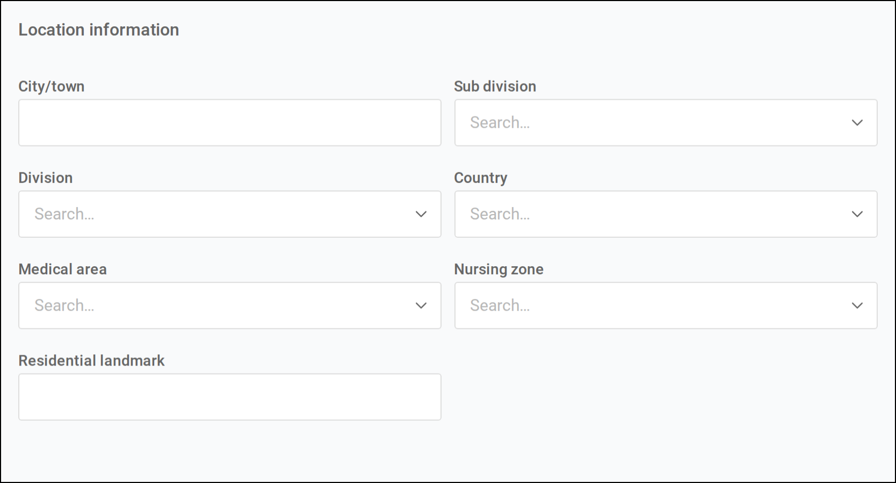

The reference data behind patient records in Tamanu: the lists that patient detail fields choose from,
secondary ID types, the address hierarchy, custom patient fields, the patient history lists, and the
patient import sheet. Reference data is configured through the reference data import spreadsheet,
downloaded from and uploaded to your Tamanu system. Records can also be added and edited one at a time
on the **Manage** tab of the **Reference data** screen in the admin panel.

> [!NOTE]
> The **Manage** tab is supported from v2.54 onwards. Earlier deployments configure reference data by
> import spreadsheet only.

For the settings that control which patient fields show and how they behave see
[Settings](02-settings.md), and for the permissions required see [Permissions](03-permissions.md).

---

# Reference Data Types

See the [Tamanu Reference Data Manual](https://beyond-essential.slab.com/public/posts/tamanu-reference-data-manual-intf5xei) for how importing works.

## Patient details

These reference data types populate the fields on a patient's **Details** tab, and the same fields
when registering a new patient, on desktop and mobile.

   
  The <b>Sub division</b>, <b>Division</b>, <b>Country</b>, <b>Medical area</b> and <b>Nursing zone</b> fields choose from reference data.

Each type has its own tab. The importer also accepts the plural of a tab name, such as `Villages`.

| Tab name | Populates |
| --- | --- |
| `Village` | **Village**, in the general information at the top of the **Details** tab |
| `Division` | **Division** |
| `Subdivision` | **Sub division** |
| `Settlement` | **Settlement** |
| `Medical Area` | **Medical area** |
| `Nursing Zone` | **Nursing zone** |
| `Country` | **Country**, and **Country of birth** |
| `Nationality` | **Nationality** |
| `Ethnicity` | **Ethnicity** |
| `Religion` | **Religion** |
| `Occupation` | **Occupation** |
| `Patient Billing Type` | **Patient type** |
| `Insurer` | **Insurer**, which shows only when the insurer fields are turned on. See [Insurer fields](02-settings.md#insurer-fields) |
| `Contact Relationship` | **Relationship**, when adding a reminder contact. See [Reminder contacts](02-settings.md#reminder-contacts) |

Division, subdivision, settlement and village can be linked into a hierarchy, so that choosing one
narrows the choices below it. See [Address hierarchy](#address-hierarchy).

> [!WARNING]
> The tab for subdivisions must be named `Subdivision` or `Subdivisions`, as a single word. A tab named
> `Sub Divisions` is not recognised and is skipped without an error.

Every patient details type takes the same columns. Where * is a required field.

| Column name | Description |
| --- | --- |
| id * | Unique id for the record. Letters, numbers and hyphens only. |
| code * | Unique code for the record. Letters, numbers, hyphens, full stops and forward slashes only. |
| name * | The name displayed in Tamanu. |
| visibilityStatus | `current` for values available for selection, or `historical` for values that should no longer be selectable. A historical value stays on the patient records that already hold it. Defaults to `current` if blank. |
| availableFacilities | Has no effect on patient detail fields: a value restricted to some facilities is still offered at every facility. Leave blank. |

Any other column in these tabs is ignored on import.

---

## Secondary Id Type

A secondary ID is an earlier identifier for a patient. When a user changes a patient's display ID on
desktop, the old ID is saved as a secondary ID, and searching the **All patients** list by the old ID
still finds the patient. Secondary IDs are not shown anywhere on the patient record. See
[Display ID](02-settings.md#display-id).

| Field | Value |
| --- | --- |
| Tab name | `Secondary Id Type` |

> [!CAUTION]
> Where display IDs can be edited, both of the records below must exist. Each saved ID is filed under
> one of them, depending on whether the old ID was generated by Tamanu or entered by a user. Without the
> matching record, saving a changed display ID fails.
>
> - id `secondaryIdType-tamanu-display-id`, code `tamanu-display-id`, name `Tamanu Display ID`
> - id `secondaryIdType-nhn`, code `nhn`, name `National Health Number`

The columns are the same as for [Patient details](#patient-details).

---

## Address hierarchy

The address hierarchy links divisions, subdivisions, settlements and villages, so that on a patient's
**Details** tab choosing a division narrows the subdivisions offered, and so on down to the village. It
takes effect once the location hierarchy setting is turned on. See
[Location hierarchy](02-settings.md#location-hierarchy).

**[Screenshot: the linked Division, Sub division, Settlement and Village fields in the Location information section of a patient's Details tab]**

The records themselves are imported as [Patient details](#patient-details) reference data. The links
between them are imported on a separate tab, one row per link from a record to the record above it.

| Field | Value |
| --- | --- |
| Tab name | `Reference Data Relation` |

Where * is a required field.

| Column name | Description |
| --- | --- |
| id | Filled in on export. Leave blank for a new row. |
| type * | Always `address_hierarchy` for the address hierarchy. The importer does not reject a blank `type`, but a blank row cannot then be matched when the sheet is imported again, so always fill it in. |
| referenceDataParentId * | The `id` of the record one level up, for example the division a subdivision belongs to. |
| referenceDataId * | The `id` of the record one level down, for example the subdivision. |

A row is matched on its two ids and its type, so re-importing an exported sheet updates the existing
links rather than duplicating them.

The levels shown on the patient form are worked out from the hierarchy itself. Tamanu takes a village
that has a parent and shows each level above it, so every village must sit at the same depth, and
every level in use must be linked all the way up. A hierarchy can skip a level, such as linking
villages straight to divisions, in which case that level does not show.

---

## Custom patient fields

Custom patient fields add fields that are not in Tamanu's standard set to patient details, on desktop
and mobile. Each field sits under a category, and each category shows as its own section heading on
the patient's **Details** tab and when registering a patient. Two reference data types configure them:
`Patient Field Def Category`, which creates the sections, and `Patient Field Definition`, which creates
the fields within them.

**[Screenshot: a custom field category and its fields on a patient's Details tab]**

Categories are shown in alphabetical order of name, and fields within a category in alphabetical order
of name. To control the order, name them accordingly.

Custom patient fields cannot be hidden, made mandatory or given a default value through settings. They
can be imported against when [importing patients](#patients).

### Patient Field Def Category

The tab name is shortened to fit the spreadsheet's limit on tab name length.

| Field | Value |
| --- | --- |
| Tab name | `Patient Field Def Category` |

Where * is a required field.

| Column name | Description |
| --- | --- |
| id * | Unique id for the category. Letters, numbers and hyphens only. |
| name * | The section heading displayed above the category's fields. |

### Patient Field Definition

Import it after, or at the same time as, Patient Field Def Category, so the categories it references
already exist.

| Field | Value |
| --- | --- |
| Tab name | `Patient Field Definition` |

Where * is a required field.

| Column name | Description |
| --- | --- |
| id * | Unique id for the field. Letters, numbers and hyphens only. This id is also the column header used when importing patients. |
| name * | The field label displayed in Tamanu. |
| fieldType * | One of the values listed under [Custom patient field types](#custom-patient-field-types). |
| options | For a `select` field, the options to choose from, separated by commas, for example `s,m,l,xl`. Leave blank for other field types. This column is not validated, so a `select` field left blank imports without an error and offers nothing to choose. |
| visibilityStatus | `current` for fields shown in Tamanu, or `historical` for fields that should no longer show. Values already recorded are kept. Defaults to `current` if blank. |
| categoryId * | The `id` of the category, from Patient Field Def Category, the field sits under. |

A `note` column is accepted for your own reference and is ignored on import.

An export writes `options` back as a comma-separated list, so a round trip is safe.

---

## Patient history

The patient history sections in the patient sidebar on desktop choose from the following reference data
types. The **Other patient issues** section is free text and uses no reference data.

| Tab name | Populates |
| --- | --- |
| `Allergy` | **Allergy name**, when adding to **Allergies** |
| `Reaction` | **Reaction**, when adding to **Allergies** |
| `Care Plan` | **Care plan**, when adding to **Care plans**. A care plan already added to the patient is not offered again |

**Ongoing conditions** and **Family history** choose from `Diagnosis` reference data. See the
[Diagnoses](../09-diagnoses/) configuration guides. The relationship recorded in **Family history** is
free text.

These types take the same columns as [Patient details](#patient-details).

---

## Patients

Patient records can be created and updated in bulk, for example when migrating patients from a legacy
system. Patients are imported on the **Patient data** screen of the admin panel, not the
**Reference data** screen, and the screen warns before an import that it cannot be undone.

| Field | Value |
| --- | --- |
| Tab name | `Patient` |

A row whose `id` matches an existing patient updates that patient. A row with a new `id` creates a
patient.

Where * is a required field.

| Column name | Description |
| --- | --- |
| id * | Unique id for the patient. Letters, numbers and hyphens only. For a new patient, generate a new id such as a GUID. For an existing patient, take the id from an export, as it is not shown in Tamanu. |
| displayId * | The patient's display ID, shown in Tamanu. Must not belong to another patient. |
| firstName * | The patient's first name. |
| middleName | The patient's middle name. Left empty if blank. |
| lastName * | The patient's last name. |
| culturalName | The patient's cultural or traditional name. Left empty if blank. |
| dateOfBirth * | The patient's date of birth, entered as a date cell in the spreadsheet. A date typed as text fails the import with a wrong input format error. |
| dateOfDeath | Marks the patient as deceased, entered as text in the format `yyyy-mm-dd hh:mm:ss`. See the warning below. Leave blank for a living patient. |
| sex * | `male`, `female` or `other`. |
| email | The patient's email address. Left empty if blank. |
| visibilityStatus | Filled in on export. Leave as exported, or blank for a new patient. |
| villageId | The `id` of the patient's village, from `Village` reference data. Left empty if blank. |

> [!WARNING]
> A date of death imported here marks the patient as deceased with no death record behind it: no cause
> of death or certifying clinician, and the patient's open encounters are not discharged. Record deaths
> in Tamanu wherever possible. See [Patient deaths](02-settings.md#patient-deaths).

### Additional details

The patient's other details are imported from further columns on the same row, but only when the
row's `patientAdditionalData` column is `TRUE`. Without it, these columns are ignored without an error.

| Column name | Description |
| --- | --- |
| patientAdditionalData | `TRUE` to import the columns below for this patient. |
| birthCertificate, drivingLicense, passport | Identification numbers, as free text. |
| primaryContactNumber, secondaryContactNumber, emergencyContactName, emergencyContactNumber | Contact details, as free text. |
| title, maritalStatus, bloodType, educationalLevel, socialMedia | A value from the matching list under [Hard coded fields](#hard-coded-fields), in the value form shown there. These columns are not validated, so a value outside the list imports without an error and does not display correctly. |
| placeOfBirth, cityTown, streetVillage | Birth location, city or town, and residential landmark, as free text. |
| countryOfBirthId, nationalityId, ethnicityId, religionId, occupationId, patientBillingTypeId, countryId, divisionId, subdivisionId, settlementId, medicalAreaId, nursingZoneId | The `id` of a record from the matching [Patient details](#patient-details) reference data. Country of birth uses `Country`. |
| motherId, fatherId | The `id` of the mother's or father's own patient record. |

Each of these is left empty for the patient where its cell is blank.

### Custom patient field values

To import values for custom patient fields, add a column for each field, headed with the field's `id`
from Patient Field Definition. The field must already exist.

| Field type | Value |
| --- | --- |
| `string` | Free text. |
| `number` | A number. Anything else fails the import. |
| `select` | One of the field's options, exactly as written in `options`, including capitals. Anything else fails the import. |

A column header that is not a patient column and not a custom field id fails the import, reporting that
there is no such patient field definition.

### Exporting patients

An export from the **Patient data** screen holds the patient columns in the first table above, with
the date of birth as a date cell, so it can be edited and imported again. It does not include
additional details or custom field values.

---

# Hard coded fields

The following fields are hard coded in Tamanu and cannot be configured. To request a new value, make a
request to your system administrator or Tamanu project manager.

Input the value shown in the left column, for example when importing patients or setting a
[default value](02-settings.md#patient-fields). Where a value displays differently in Tamanu, the
display label is shown alongside it.

## Sex

| Value | Displays as |
| --- | --- |
| male | Male |
| female | Female |
| other | Other |

**Other** is not offered unless the setting that hides it is turned off. See [Sex](02-settings.md#sex).

## Title

`Mr`, `Mrs`, `Ms`, `Miss`, `Dr`, `Sr`, `Sn`

## Marital status

| Value | Displays as |
| --- | --- |
| Defacto | De facto |
| Married | Married |
| Single | Single |
| Widow | Widow |
| Divorced | Divorced |
| Separated | Separated |
| Unknown | Unknown |

## Blood type

`A+`, `A-`, `AB+`, `AB-`, `B+`, `B-`, `O+`, `O-`

## Educational attainment

Used for `educationalLevel`.

`No formal schooling`, `Less than primary school`, `Primary school completed`,
`Sec school completed`, `High school completed`, `University completed`, `Post grad completed`

## Social media

`Facebook`, `Instagram`, `LinkedIn`, `Twitter`, `Viber`, `WhatsApp`

## Birth details

Used by the birth details recorded when registering a birth on desktop.

**Place of birth**

| Value | Displays as |
| --- | --- |
| health_facility | Health facility |
| home | Home |
| other | Other |

**Attendant at birth**

| Value | Displays as |
| --- | --- |
| doctor | Doctor |
| midwife | Midwife |
| nurse | Nurse |
| traditional_birth_attentdant | Traditional birth attendant |
| other | Other |

**Delivery type**

| Value | Displays as |
| --- | --- |
| normal_vaginal_delivery | Normal vaginal delivery |
| breech | Breech |
| emergency_c_section | Emergency C-section |
| elective_c_section | Elective C-section |
| vacuum_extraction | Vacuum extraction |
| forceps | Forceps |
| other | Other |

**Single/Plural birth**

| Value | Displays as |
| --- | --- |
| single | Single |
| plural | Plural |

## Custom patient field types

Used for `fieldType` in Patient Field Definition.

| Value | Field shown |
| --- | --- |
| string | A free text box |
| number | A number box |
| select | A list of the options set in `options` |

## Patient issue type

Chosen when adding to **Other patient issues**.

| Value | Displays as |
| --- | --- |
| issue | Issue |
| warning | Warning |

A **Warning** also shows in a **Patient warnings** pop-up when the patient's record is opened.
