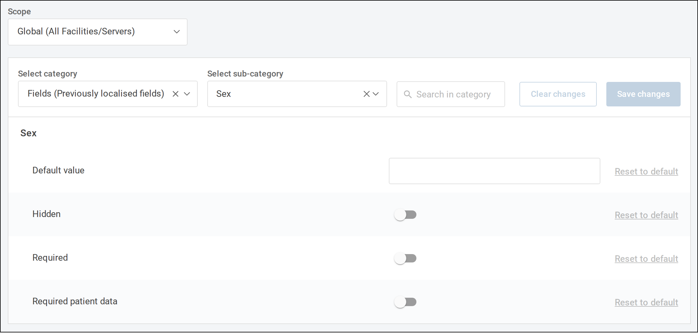
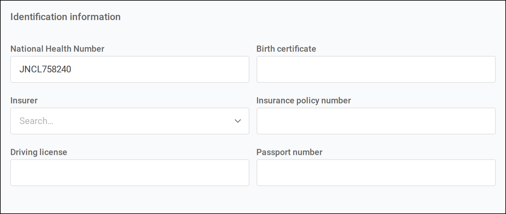
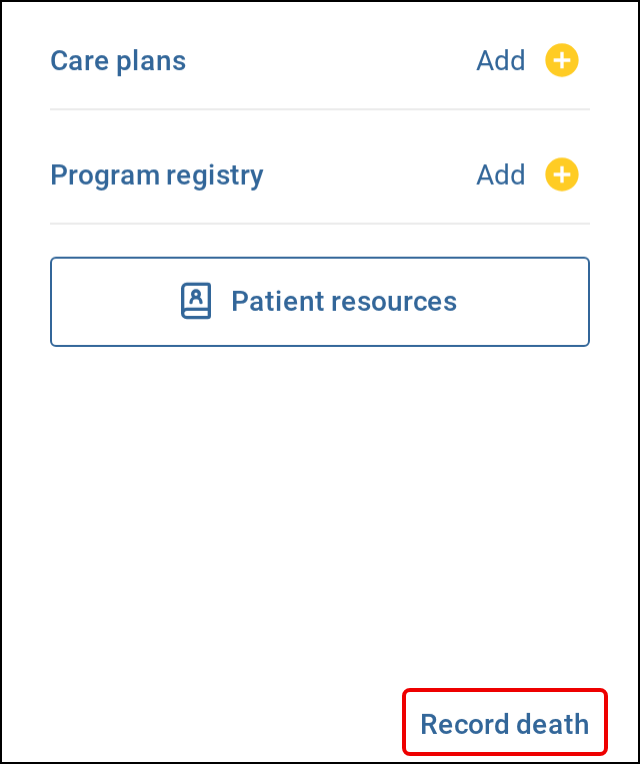
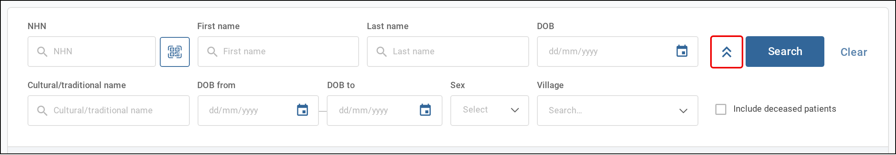
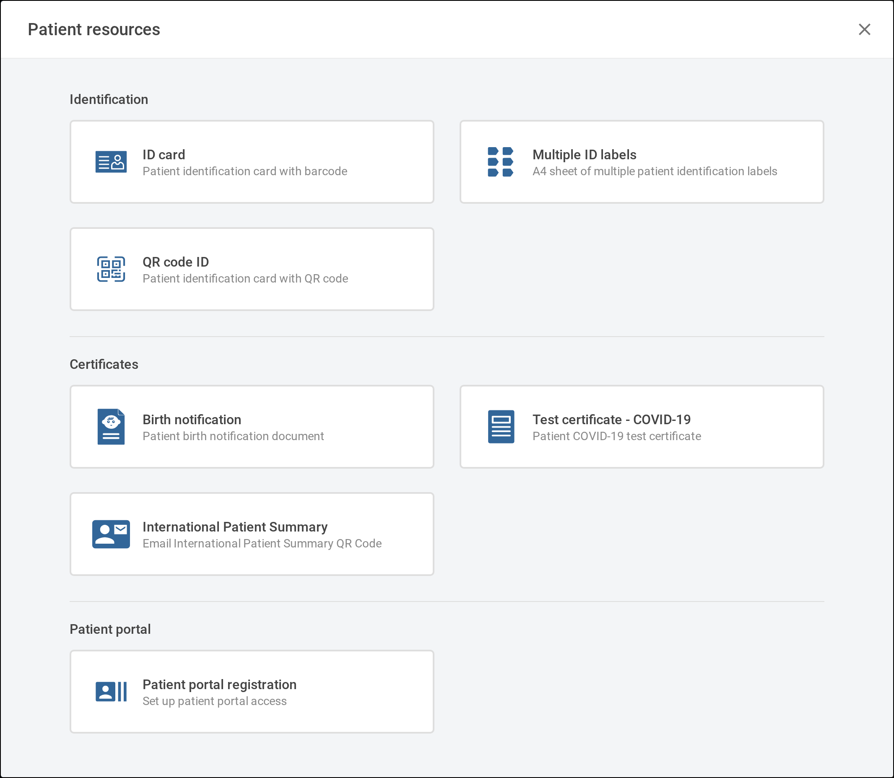
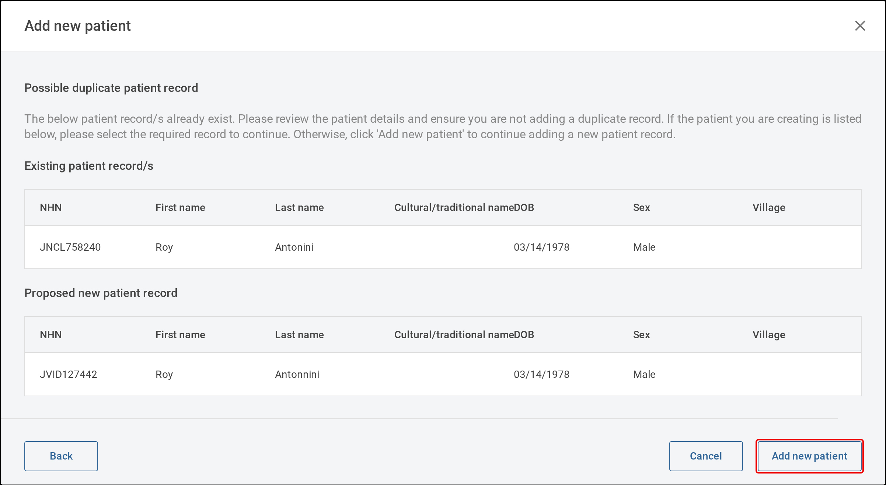

The settings that shape patient records in Tamanu: which patient fields show and which are mandatory,
how display IDs are generated and edited, patient search, the patient screens' layout, ID card and
label printing, patient deaths, the patient portal and the AI patient summary, and the automated
behaviour around them. Settings are managed in the Settings admin panel.

For the reference data these settings act on see [Reference data](01-reference-data.md), and for the
permissions required see [Permissions](03-permissions.md).

---

# Settings

Settings are managed in the Settings admin panel. A few settings in this guide are marked high risk:
they are changed by a user with the `admin` role, and other users see them disabled. See
[The admin role](../02-users/03-permissions.md#the-admin-role).

## Patient fields

The **Fields (Previously localised fields)** category holds a sub-category for each patient field, and
each sub-category holds the settings that decide whether the field is mandatory, whether it shows, and
what it is filled in with by default. They apply across the deployment.

   
  Each field's sub-category holds <b>Default value</b>, <b>Hidden</b>, <b>Required</b> and <b>Required patient data</b>.

### Making a field mandatory

A field marked as required patient data must be filled in to register a patient or save their details,
on desktop and mobile. It also moves from its usual section to the general information at the top of
the form, so that every mandatory field is together.

| Field | Value |
| --- | --- |
| Scope | Global (All Facilities/Servers) |
| Category | Fields (Previously localised fields) |
| Sub-category | The field, for example Passport |
| Setting | Required patient data |
| Default | Disabled |

The **Required** setting in the same sub-category has no effect on the patient details form. Use
**Required patient data**.

First name, last name, date of birth and sex are always mandatory. Birth details marked as required
patient data are only enforced when registering a birth.

> [!WARNING]
> Only mark a field as required patient data if it shows on the form. A mandatory field that does not
> show still has to be filled in, so no patient can be saved on desktop. This is the case for a field
> that is also hidden, for **Health center**, which has no field on desktop, and for **Insurer** and
> **Insurer policy number** unless the [insurer fields](#insurer-fields) are turned on.

### Hiding a field

Fields not relevant to a deployment can be hidden, on desktop and mobile. A hidden field is also
removed from the patient search where it appears there.

| Field | Value |
| --- | --- |
| Scope | Global (All Facilities/Servers) |
| Category | Fields (Previously localised fields) |
| Sub-category | The field, for example Cultural name |
| Setting | Hidden |
| Default | Disabled |

First name, last name, date of birth, display ID and the emergency contact fields cannot be hidden, and
have no **Hidden** setting.

### Setting a default value

Where most patients share a response, such as their country, a default value fills the field in when a
patient is registered on desktop. The user can change or clear it. Defaults are not applied on mobile,
on the patient's **Details** tab once they are registered, or to custom patient fields.

| Field | Value |
| --- | --- |
| Scope | Global (All Facilities/Servers) |
| Category | Fields (Previously localised fields) |
| Sub-category | The field, for example Country |
| Setting | Default value |
| Default | None |

For a field that chooses from reference data, the default value is the `id` of the record, for example
`country-Fiji`. For a field with a hard coded list, it is the value from that list, for example
`Married`. See [Hard coded fields](01-reference-data.md#hard-coded-fields).

### Changing a field label

A field's label is changed on the **Translation** screen of the admin panel rather than in settings,
for example to show **Cultural/traditional name** as **Maiden name**. Most patient fields are found
under the string id `general.localisedField.` followed by the field name and `.label`, such as
`general.localisedField.culturalName.label`. See the
[Translations configuration guide](https://beyond-essential.slab.com/public/posts/translations-module-configuration-guide-qvs6uaxp).

### Patient fields reference

The patient fields in the **Fields (Previously localised fields)** category, by the sub-category name
in Settings and the label on the desktop form. The category also holds fields belonging to other
modules, such as encounter fields.

| Sub-category | Label on desktop | Section |
| --- | --- | --- |
| First name | First name | General information |
| Middle name | Middle name | General information |
| Last name | Last name | General information |
| Cultural name | Cultural/traditional name | General information |
| Date of birth | Date of birth | General information |
| Village | Village | General information, or Location information when the [location hierarchy](#location-hierarchy) is on |
| Sex | Sex | General information |
| Email | Email address | General information |
| Display ID | National Health Number | Identification information, once registered |
| Birth certificate | Birth certificate | Identification information |
| Insurer | Insurer | Identification information |
| Insurer policy number | Insurance policy number | Identification information |
| Driving license | Driving license | Identification information |
| Passport | Passport number | Identification information |
| Primary contact number | Primary contact number | Contact information |
| Secondary contact number | Secondary contact number | Contact information |
| Emergency contact name | Emergency contact name | Contact information |
| Emergency contact number | Emergency contact number | Contact information |
| Title | Title | Personal information |
| Marital status | Marital status | Personal information |
| Blood type | Blood type | Personal information |
| Place of birth | Birth location | Personal information |
| Country of birth | Country of birth | Personal information |
| Nationality | Nationality | Personal information |
| Ethnicity | Ethnicity | Personal information |
| Religion | Religion | Personal information |
| Educational level | Educational attainment | Personal information |
| Occupation | Occupation | Personal information |
| Social media | Social media | Personal information |
| Patient billing type | Patient type | Personal information |
| Mother | Mother | Personal information |
| Father | Father | Personal information |
| Insurance plan | Insurance plan | Personal information |
| City town | City/town | Location information |
| Subdivision | Sub division | Location information |
| Division | Division | Location information |
| Country | Country | Location information |
| Settlement | Settlement | Location information |
| Medical area | Medical area | Location information |
| Nursing zone | Nursing zone | Location information |
| Street village | Residential landmark | Location information |
| Time of birth | Time of birth | Birth details |
| Gestational age estimate | Gestational age (weeks) | Birth details |
| Registered birth place | Place of birth | Birth details |
| Birth facility | Name of health facility (if applicable) | Birth details |
| Attendant at birth | Attendant at birth | Birth details |
| Name of attendant at birth | Name of attendant | Birth details |
| Birth delivery type | Delivery type | Birth details |
| Birth type | Single/Plural birth | Birth details |
| Birth order | Birth order | Birth details |
| Birth weight | Birth weight (kg) | Birth details |
| Birth length | Birth length (cm) | Birth details |
| Apgar score after one minute | Apgar score at 1 min | Birth details |
| Apgar score after five minutes | Apgar score at 5 min | Birth details |
| Apgar score after ten minutes | Apgar score at 10 min | Birth details |

Birth details show only when registering a birth on desktop, and on the patient's **Details** tab
afterwards.

---

## Display ID

Every patient has a display ID, the identifier shown on their record, printed on ID cards and labels,
and used to search for them. It shows as **National Health Number** by default, a label that can be
changed through translations. See [Changing a field label](#changing-a-field-label).

### Display ID format (supported from v2.49 onwards)

Tamanu generates a display ID when a patient is registered, on desktop and mobile, following a pattern
set for each facility.

| Field | Value |
| --- | --- |
| Scope | Facility (Single Facility) |
| Category | None |
| Sub-category | None |
| Setting | Patient display id pattern |
| Default | `AAAA000000`, four random letters then six random numbers |

The setting is marked high risk.

In the pattern, `A` is replaced with a random letter and `0` with a random number. Characters wrapped
in square brackets are kept as they are, so `[B]AAAA000000` generates an 11 character ID starting with
B. The pattern is made only of `A`, `0` and bracketed characters, and any other character is rejected
when the setting is saved.

> [!NOTE]
> Deployments running a version earlier than v2.49 generate display IDs in the default format only.

### Editing a display ID

A display ID can be changed on the patient's **Details** tab on desktop, once the patient is registered.
New patients always start with a generated ID. Display IDs cannot be edited on mobile.

| Field | Value |
| --- | --- |
| Scope | Global (All Facilities/Servers) |
| Category | Features |
| Sub-category | None |
| Setting | Edit patient display id |
| Default | Enabled |

   
  The display ID is edited in <b>National Health Number</b> under <b>Identification information</b>.

When a display ID is changed, the old ID is kept as a secondary ID, so searching the **All patients**
list by the old ID still finds the patient. A display ID already used by another patient is refused,
ignoring capitals.

> [!CAUTION]
> Editing a display ID needs the two secondary ID type records listed under
> [Secondary Id Type](01-reference-data.md#secondary-id-type). Without them, saving a changed display ID
> fails.

### Display ID validation

Where display IDs can be edited, a pattern can be set that a changed display ID must match, for example
to accept only nine-digit IDs. A display ID that does not match shows **Invalid National Health
Number** and cannot be saved. The pattern also applies when a display ID is entered by scanning a QR
code.

| Field | Value |
| --- | --- |
| Scope | Global (All Facilities/Servers) |
| Category | Fields (Previously localised fields) |
| Sub-category | Display ID |
| Setting | Pattern |
| Default | `[\s\S]*`, which accepts any value |

The pattern is a regular expression. It is matched anywhere within the display ID unless it is anchored,
so to require the whole ID to match, start it with `^` and end it with `$`. For example, `^\d{9}$`
accepts exactly nine digits.

Generated display IDs are not checked against this pattern, so keep the two consistent.

---

## Sex

By default, sex is recorded as **Male** or **Female**. Turn this setting off to also offer **Other**,
on the patient form, in patient search and in forms, on desktop and mobile.

| Field | Value |
| --- | --- |
| Scope | Global (All Facilities/Servers) |
| Category | Features |
| Sub-category | None |
| Setting | Hide other sex |
| Default | Enabled, so **Other** is not offered |

## Insurer fields

Adds **Insurer** and **Insurance policy number** to the identification information on a patient's
**Details** tab on desktop, and shows the patient's insurer on printed invoices. The insurers to choose
from are configured as `Insurer` reference data. See [Patient details](01-reference-data.md#patient-details).

| Field | Value |
| --- | --- |
| Scope | Global (All Facilities/Servers) |
| Category | Features |
| Sub-category | None |
| Setting | Enable patient insurer |
| Default | Disabled |

## Location hierarchy

Replaces the separate **Division**, **Sub division**, **Settlement** and **Village** fields on desktop
with linked fields, so that choosing one narrows the choices below it. **Village** moves from the
general information to the location information. Mobile keeps the separate fields.

| Field | Value |
| --- | --- |
| Scope | Global (All Facilities/Servers) |
| Category | Features |
| Sub-category | None |
| Setting | Patient details location hierarchy |
| Default | Disabled |

> [!CAUTION]
> Turn this on only once the address hierarchy has been imported. See
> [Address hierarchy](01-reference-data.md#address-hierarchy).

## Patient deaths

Allows a patient's death to be recorded on desktop, with **Record death** in the patient sidebar.
Deaths cannot be recorded on mobile.

| Field | Value |
| --- | --- |
| Scope | Global (All Facilities/Servers) |
| Category | Features |
| Sub-category | None |
| Setting | Enable patient deaths |
| Default | Disabled |

   
  Select <b>Record death</b> at the bottom of the patient sidebar.

A death can be recorded in two ways:

- **Save and close** on the first screen records only the date and time of death and the attending
  clinician. The record is not final, and **Revert death record** can undo it
- Completing every screen and selecting **Submit** records the full cause of death. The record is
  final and cannot be reverted

The cause of death and contributing conditions choose from `Diagnosis` reference data. See the
[Diagnoses](../09-diagnoses/) configuration guides. A deceased patient's record becomes read only.

Recording a death discharges the patient's open encounters. See
[Discharge on death](#discharge-on-death).

## Civil registration style (supported from v2.51 onwards)

Switches the death form, the death certificate and the **Birth notification** printout to the civil
registration style used in the Federated States of Micronesia. The death form asks additional
FSM-specific questions, and both printouts take the FSM layout. Leave it off elsewhere.

| Field | Value |
| --- | --- |
| Scope | Global (All Facilities/Servers) |
| Category | FSM CRVS Certificates |
| Sub-category | None |
| Setting | Enable fsm style |
| Default | Disabled |

## Reminder contacts

Reminder contacts are people, such as a parent, who receive reminder messages about a patient through
Telegram, such as reminders of upcoming vaccinations. When this setting is on, **Reminder contacts**
shows in the general information on a patient's **Details** tab on desktop, and on the patient details
screen on mobile.

| Field | Value |
| --- | --- |
| Scope | Global (All Facilities/Servers) |
| Category | Features |
| Sub-category | Reminder contact module |
| Setting | Enabled |
| Default | Disabled |

A contact is connected by scanning a QR code with Telegram, so the Telegram bot must be set up. See the
[Integrations](../24-integrations/) configuration guides. The relationships to choose from are
configured as `Contact Relationship` reference data. See
[Patient details](01-reference-data.md#patient-details). Vaccination reminders are covered in the
[Immunisations](../07-immunisations/) configuration guides.

## Tamanu Mobile

Registering patients and editing their details on mobile are each switched on or off for the whole
deployment.

**Register new patient** shows the button to register a patient on the mobile home screen.

| Field | Value |
| --- | --- |
| Scope | Global (All Facilities/Servers) |
| Category | Features |
| Sub-category | None |
| Setting | Register new patient |
| Default | Enabled |

**Edit patient details on mobile** allows the patient's details to be edited on mobile.

| Field | Value |
| --- | --- |
| Scope | Global (All Facilities/Servers) |
| Category | Features |
| Sub-category | None |
| Setting | Edit patient details on mobile |
| Default | Enabled |

---

## Patient search

The **All patients** list on desktop searches by display ID, first name, last name and date of birth,
and its expanded search by cultural name, a date of birth range, sex and village, with an option to
include deceased patients. Further fields can be added to the expanded search.

| Field | Value |
| --- | --- |
| Scope | Global (All Facilities/Servers) |
| Category | Patient search |
| Sub-category | None |
| Setting | Additional search fields |
| Default | None |

   
  Select the expand button to show the expanded search, where additional search fields appear.

Choose the fields from the **Search fields** list. They show in the expanded search in the order
chosen. A field that picks from reference data is searched by choosing a value. Any other field finds
patients whose value starts with the text entered, ignoring capitals.

The fields that can be added are middle name, email, date of death, visibility status, the
identification and contact fields, title, marital status, blood type, birth location, educational
attainment, social media, city/town, residential landmark, and the fields that choose from patient
details reference data.

> [!WARNING]
> **Country Of Birth Id** and **Secondary Village Id** are offered in the list, but their search field
> finds no values to choose from. Leave them out.

Additional search fields are supported from v2.54 onwards, and are chosen from a list from v2.62.
Between those versions the setting takes a list of field names in the JSON editor, such as
`["passport", "nationalityId"]`.

## Age display

Patient ages are shown in the unit that suits the patient's age, for example in days for a newborn.

| Field | Value |
| --- | --- |
| Scope | Global (All Facilities/Servers) |
| Category | None |
| Sub-category | None |
| Setting | Age display format |
| Default | Days until 8 days old, then weeks until 1 month old, then months until 2 years old, then years |

The setting reads as a sentence: **Show age in** a unit **until** an age, **then in** the next unit,
ending with the unit used **onward**. Select **Add range** to add a step. The last step has no upper
age. Before v2.62 the setting is edited as JSON in the JSON editor.

---

## Patient view layout

### Patient tabs

The tabs on a patient's record on desktop can be reordered, and all but **Summary** and **Details** can
be hidden.

| Field | Value |
| --- | --- |
| Scope | Global (All Facilities/Servers) |
| Category | Layouts |
| Sub-category | Patient tabs |
| Setting | Sort priority, and Hidden, for each tab |
| Default | **Summary** then **Details** first, followed by the other tabs in their standard order, none hidden |

Tabs are shown in ascending order of sort priority. **Summary** and **Details** have a sort priority
of -100 by default and every other tab 0. In Settings the tabs are named by their key: `programs` is
the **Forms** tab.

Some tabs also depend on other configuration: **Medication** needs `list` for `Medication`, and
**Invoices** shows only when invoicing is turned on.

### Patients sidebar items

The **Inpatients**, **Emergency patients** and **Outpatients** items under **Patients** in the desktop
sidebar can be reordered or hidden. **All patients** always shows first.

| Field | Value |
| --- | --- |
| Scope | Global (All Facilities/Servers) |
| Category | Layouts |
| Sub-category | Sidebar |
| Setting | Sort priority, and Hidden, under Patients for each item |
| Default | All shown, in the order above |

### Mobile patient home

The modules on a patient's home screen on mobile can be reordered or hidden: **Diagnosis & Treatment**,
**Vitals**, **Programs**, **Referral**, **Vaccine** and **Tests**. The **Program registries** menu
button can be hidden but not reordered.

| Field | Value |
| --- | --- |
| Scope | Global (All Facilities/Servers) |
| Category | Layouts |
| Sub-category | Mobile patient modules |
| Setting | Sort priority, and Hidden, for each module |
| Default | All shown, in the order above |

---

## ID cards and labels

**Patient resources** in the patient sidebar on desktop opens a window for printing identification and
certificates for the patient.

   
  The <b>Patient resources</b> window.

The identification options are always offered:

- **ID card**, a patient identification card with a barcode
- **Multiple ID labels**, an A4 sheet of patient identification labels with a barcode that reads as
  the display ID when scanned
- **QR code ID**, a patient identification card with a QR code (supported from v2.53 onwards)

**Birth notification** prints the birth notification document, drawing on the mother's, father's and
child's details where they are recorded. The COVID-19 certificates are covered in the
[Immunisations](../07-immunisations/) configuration guides, **International Patient Summary** under
[Permissions](03-permissions.md#patient-resources), and **Patient portal registration** under
[Patient portal](#patient-portal-supported-from-v242-onwards).

The ID card shows the patient's photo from the most recent form answer to a question with the code
`ProfilePhoto`. See the [Programs](../06-programs/) configuration guides for setting up forms.

### Print measures

The page and card measures can be adjusted to suit the card printer or label stock in use. All measures
are in millimetres.

| Field | Value |
| --- | --- |
| Scope | Global (All Facilities/Servers) |
| Category | Print measures |
| Sub-category | Id card page |
| Setting | Card margin top, Card margin left |
| Default | 1 mm top, 5 mm left |

The ID card measures apply to both **ID card** and **QR code ID**.

| Field | Value |
| --- | --- |
| Scope | Global (All Facilities/Servers) |
| Category | Print measures |
| Sub-category | Sticker label page |
| Setting | Page width, Page height, Page margin top, Page margin left, Column width, Column gap, Row height, Row gap |
| Default | An A4 page (210 by 297 mm) with a 15.09 mm top margin and 6.4 mm left margin, 64 mm columns 3.01 mm apart, and 26.7 mm rows with no gap |

---

# Patient portal (supported from v2.42 onwards)

> [!NOTE]
> Deployments running a version earlier than v2.42 have no patient portal.

The patient portal is a website where patients log in with a code sent to their email address. They
see their details, ongoing conditions, allergies, medications, vaccinations, procedures and upcoming
appointments, and complete forms that staff send them.

Staff register a patient for the portal from **Patient portal registration** in **Patient resources**,
which emails the patient a registration link, and send forms with **Send to patient portal** when
choosing a form. Sending a form to an unregistered patient registers them at the same time. An email
address can belong to only one patient.

## Enabling the patient portal

| Field | Value |
| --- | --- |
| Scope | Global (All Facilities/Servers) |
| Category | Features |
| Sub-category | None |
| Setting | Patient portal |
| Default | Disabled |

The setting is marked high risk. While it is off, the portal cannot be reached and the registration
and form options are hidden in Tamanu.

## Portal address

The web address the portal is served from, used to build the links in the portal's emails.

| Field | Value |
| --- | --- |
| Scope | Global (All Facilities/Servers) |
| Category | Patient portal |
| Sub-category | None |
| Setting | Base url |
| Default | None. Required for the patient portal |

> [!CAUTION]
> Without the base url, registration and form emails are not sent.

## Login and registration links

| Field | Value |
| --- | --- |
| Scope | Central (Sync server) |
| Category | Patient portal |
| Sub-category | None |
| Setting | Login token duration |
| Default | 20 minutes |

How long the code emailed to a patient to log in stays valid.

| Field | Value |
| --- | --- |
| Scope | Central (Sync server) |
| Category | Patient portal |
| Sub-category | None |
| Setting | Register token duration |
| Default | 43,800 minutes, about 30 days |

How long a registration link stays valid.

| Field | Value |
| --- | --- |
| Scope | Central (Sync server) |
| Category | Patient portal |
| Sub-category | None |
| Setting | Token duration |
| Default | `24h` |

How long a patient stays logged in, written as a number and unit such as `24h` or `30m`.

## Portal emails

The subject and body of each email the portal sends can be changed.

| Field | Value |
| --- | --- |
| Scope | Global (All Facilities/Servers) |
| Category | Templates |
| Sub-category | Patient portal login email, Patient portal registration email, Patient portal registered form email, Patient portal unregistered form email |
| Setting | Subject, Body |
| Default | Standard wording for each email |

Words between dollar signs are replaced when the email is sent:

| Placeholder | Replaced with | Used in |
| --- | --- | --- |
| `$token$` | The six-digit login code | Login email |
| `$firstName$`, `$lastName$` | The patient's name | Registration and form emails |
| `$facilityName$` | The facility the email was sent from | Registration and form emails |
| `$registrationLink$` | The patient's registration link | Registration email, unregistered form email |
| `$loginLink$` | The portal's login page | Registered form email |

---

# AI patient summary (supported from v2.57 onwards)

> [!NOTE]
> Deployments running a version earlier than v2.57 have no AI patient summary.

The AI patient summary shows an AI generated summary of the patient's record in the patient sidebar on
desktop, which clinicians can edit, save, discard and regenerate. It is shown only for a patient marked
for sync to the facility.

| Field | Value |
| --- | --- |
| Scope | Global (All Facilities/Servers) |
| Category | Patient summary |
| Sub-category | None |
| Setting | Enabled |
| Default | Disabled |

**[Screenshot: the AI patient summary panel in the patient sidebar]**

> [!CAUTION]
> The summary is generated through the deployment's AI service, which must also be turned on, with an
> Anthropic API key and model set, in the **AI** category at Central (Sync server) scope. Without it,
> staff see **AI summary is unavailable. Please contact your administrator.**

The instructions the summary is generated from can be changed in **System prompt** in the same
category. The default is Tamanu's standard prompt.

Viewing and generating the summary also needs the `PatientSummary` permissions. See
[AI patient summary permissions](03-permissions.md#ai-patient-summary).

---

# Automated workflows

These work without configuration.

## Duplicate patient check (supported from v2.35 onwards)

When a patient is registered on desktop, Tamanu checks for existing patients who may be the same
person. Where it finds any, the **Add new patient** window shows a
**Possible duplicate patient record** warning listing up to five, alongside the proposed new record.
Selecting an existing patient opens their record, and **Add new patient** carries on registering.
Mobile does not check.

   
  Select an existing patient to open their record, or <b>Add new patient</b> to carry on.

An existing patient is listed when all of the following hold:

- Their last name sounds the same as the new patient's
- Their last and first names together differ from the new patient's by no more than six letters
- Their date of birth differs by no more than one character, or has the day and month swapped

This catches misspellings, phonetic variations and minor typing mistakes. It misses names that sound
different, such as a mistyped first letter, and names of very different lengths, such as Peter
Alexander and Peter.

The check can be tailored for a deployment outside a version upgrade. To report over or under alerting,
contact your system administrator or Tamanu project manager.

## Discharge on death

When a death is recorded, the patient's open encounters are discharged at the time of death by the
attending clinician, with the note **Automatically discharged by registering patient death**. An open
encounter the facility could not see when the death was recorded, such as one at another facility, is
discharged by the central server within the hour.
