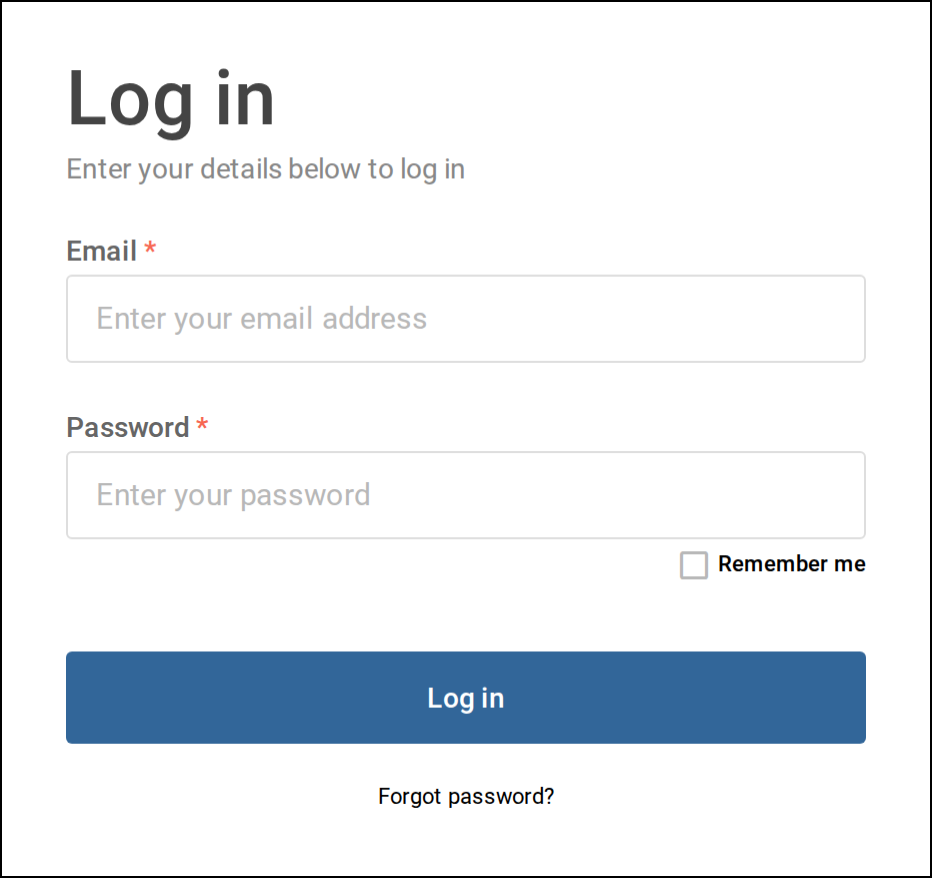
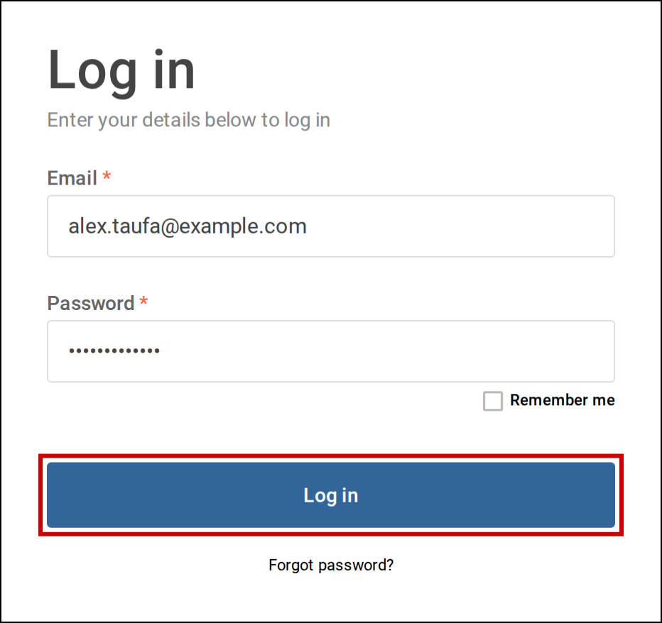
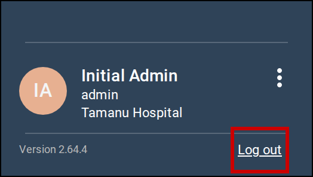

Log in to Tamanu Desktop with your email address and password, and log out when you have finished.
Start from your web browser.

# Before you start

You need your site's Tamanu address, and the email address and password for your Tamanu account. Your
system administrator gives you these.

# Log in

1. Open your site's Tamanu address in your web browser.

   The **Log in** screen opens. If you ticked **Remember me** last time, the heading says
   **Welcome back** and your email address is already filled in.

   

      
     The <b>Log in</b> screen.
   

2. Enter your email address in **Email** and your password in **Password**.

3. Tick **Remember me** if you want Tamanu to fill in your email address next time you log in on this
   computer.

   Leave it unticked to have Tamanu forget your email address.

4. Select **Log in**.

   

      
     Enter your email address and password, then select <b>Log in</b>.
   

   If your email address or password is wrong, a message appears under the heading. It may tell you
   how many attempts you have left before you are locked out. If you are locked out, the message
   says how many minutes to wait before trying again. If you have forgotten your password, see
   [Reset your password](02-reset-password.md).

5. If the **Select facility** screen opens, choose where you are working from **Facility**, then
   select **Submit**.

   This screen opens only when your account can work at more than one facility. Select **Cancel** to
   go back to the **Log in** screen.

   Tamanu opens, with the sidebar on the left of the screen.

# Log out

Your site may also log you out after a period of inactivity. Before it does, the **Login timeout**
window counts down the seconds left. Select **Stay logged in** to carry on working, or **Log out** to
log out straight away.

1. If the sidebar is collapsed, select the arrow at the top of the sidebar to expand it.

2. Select **Log out** at the bottom of the sidebar, beside the version number.

   You cannot log out while you have a note open. Save or close the note first.

   

      
     Select <b>Log out</b> at the bottom of the sidebar.
   

   The **Log in** screen opens.
