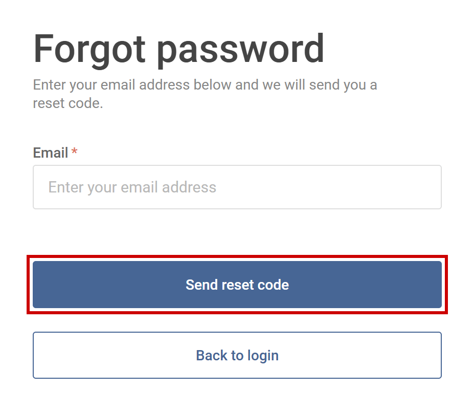
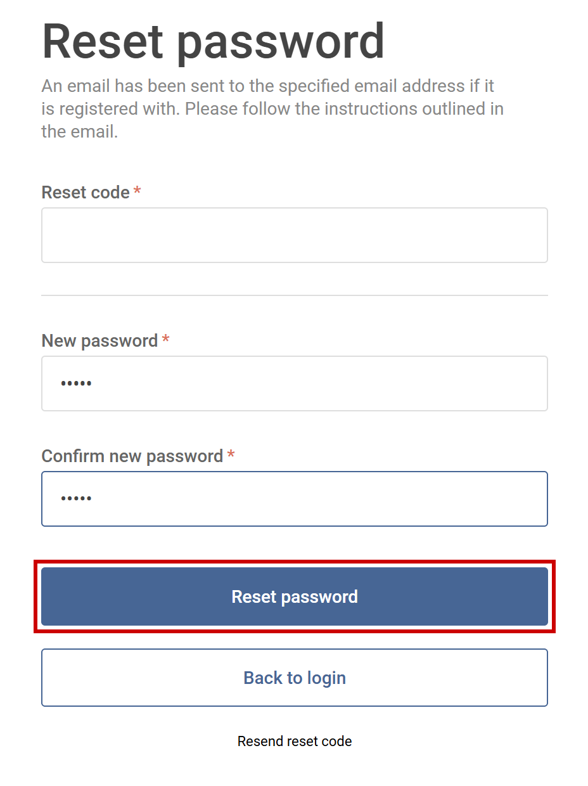
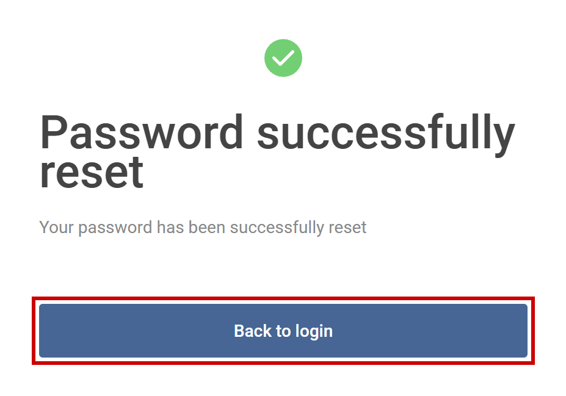

Set a new password for your Tamanu account if you have forgotten yours. Start from the **Log in**
screen.

# Before you start

You need access to the email inbox for your Tamanu account, because Tamanu sends a reset code there.

# Steps

1. Click **Forgot password?** under the **Log in** button.

   The **Forgot password** screen opens. If you ticked **Remember me** when you last logged in, your
   email address is already filled in.

   <figure>
     
     <figcaption>Enter your email address, then click <b>Send reset code</b>.</figcaption>
   </figure>

2. Enter your email address in **Email**, then click **Send reset code**.

   The **Reset password** screen opens. If the email address belongs to a Tamanu account, an email
   with a reset code is sent to it. If no email arrives, contact your system administrator.

3. Enter the code from the email in **Reset code**.

   If the code is wrong, **Code incorrect** appears under the field. To get a new code, click
   **Resend reset code**, which takes you back to the **Forgot password** screen.

4. Enter your new password in **New password**, then enter it again in **Confirm new password**.

   Your new password must be at least five characters long, and the two fields must match.

5. Click **Reset password**.

   <figure>
     
     <figcaption>Enter the reset code and your new password, then click <b>Reset password</b>.</figcaption>
   </figure>

   **Password successfully reset** appears. Click **Back to login**, then log in with your new
   password, as described in [Log in and out](01-log-in-and-out.md).

   <figure>
     
     <figcaption>Click <b>Back to login</b> to log in with your new password.</figcaption>
   </figure>
