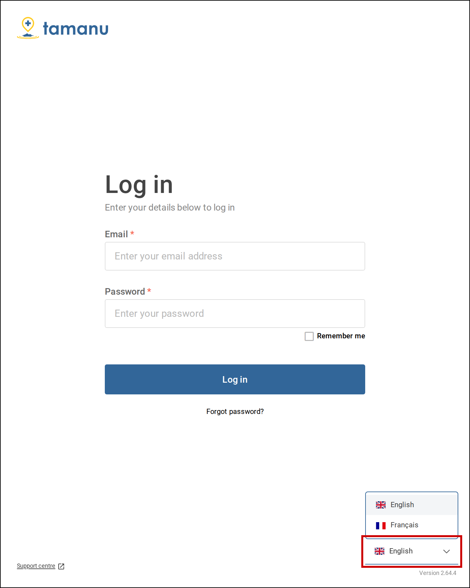
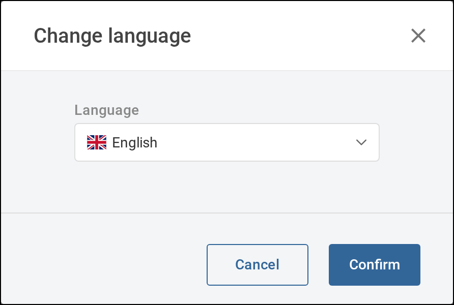

Choose the language Tamanu shows its screens in. You can change it on the **Log in** screen, or from
the sidebar once you have logged in. Tamanu remembers your choice in this web browser.

# Before you start

You can change language only if your site has set Tamanu up in more than one language. If you cannot
see **Language** on the **Log in** screen, or **Change language** in the sidebar menu, your site uses a
single language. Contact your system administrator if you believe you should be able to change it.

# On the Log in screen

1. Select **Language** at the bottom right of the **Log in** screen.

   

      
     Select the language selector at the bottom right of the <b>Log in</b> screen.
   

2. Choose your language.

   The screen changes to that language straight away.

# After logging in

1. If the sidebar is collapsed, select the arrow at the top of the sidebar to expand it.

2. Select the menu button, shown as three dots, beside your name at the bottom of the sidebar.

   A menu opens.

3. Select **Change language**.

   The **Change language** window opens.

   

      
     The <b>Change language</b> window.
   

4. Choose your language from **Language**.

5. Select **Confirm**.

   The window closes and Tamanu changes to that language.
