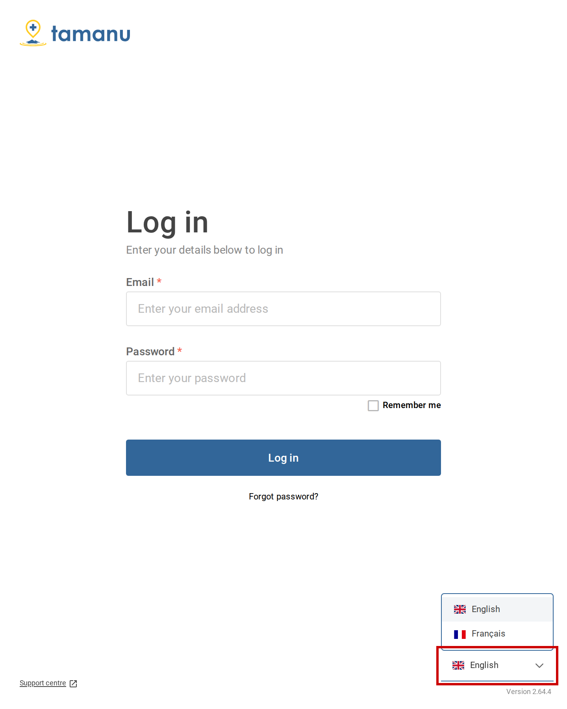
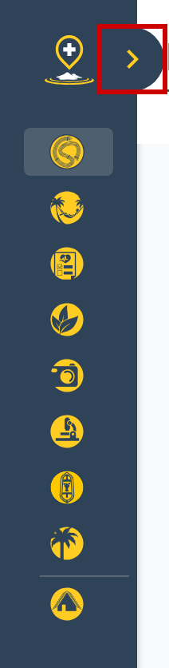
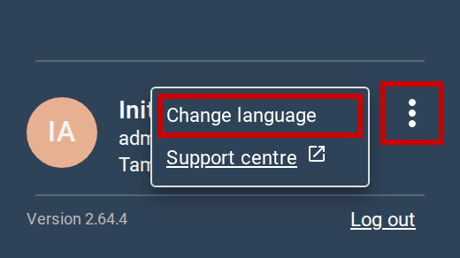
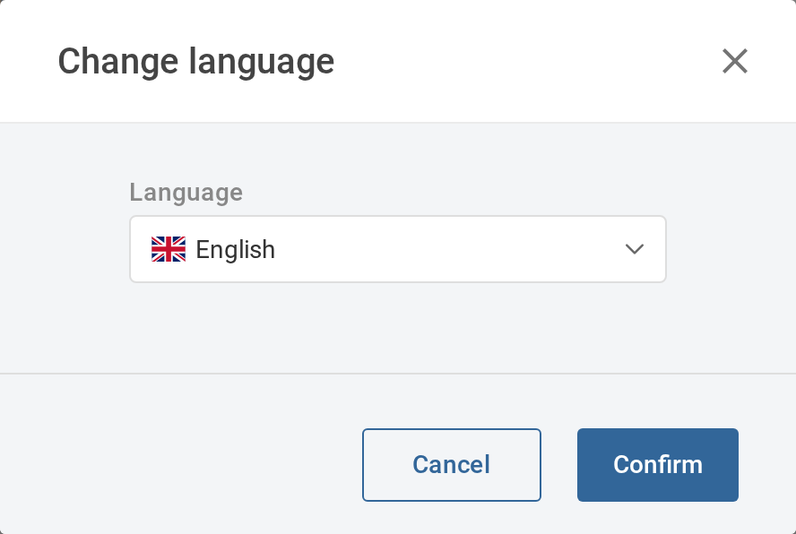

Choose the language Tamanu shows its screens in. You can change it on the **Log in** screen, or from
the sidebar once you have logged in. Tamanu remembers your choice in this web browser.

# Before you start

You can change language only if your site has set Tamanu up in more than one language. If you cannot
see **Language** on the **Log in** screen, or **Change language** in the sidebar menu, your site
uses a single language. Contact your system administrator if you believe you should be able to
change it.

# On the Log in screen

1. Click **Language** at the bottom right of the **Log in** screen.

   <figure>
     
     <figcaption>Click the language selector at the bottom right of the <b>Log in</b> screen.</figcaption>
   </figure>

2. Choose your language.

   The screen changes to that language straight away.

# After logging in

1. If the sidebar is collapsed, click the arrow at the top of the sidebar to expand it.

   <figure>
     
     <figcaption>Click the arrow at the top of the collapsed sidebar to expand it.</figcaption>
   </figure>

2. Click the More button&nbsp;(&nbsp;⋮&nbsp;) beside your name at the bottom of the sidebar.

   A menu opens.

   <figure>
     
     <figcaption>Open the More menu beside your name, then choose <b>Change language</b>.</figcaption>
   </figure>

3. Choose **Change language**.

   The **Change language** dialog opens.

   <figure>
     
     <figcaption>The <b>Change language</b> dialog.</figcaption>
   </figure>

4. Choose your language from **Language**.

5. Click **Confirm**.

   This dismisses the dialog and Tamanu changes to that language.
