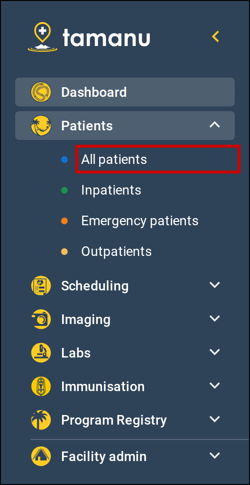
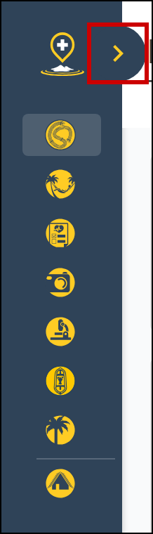
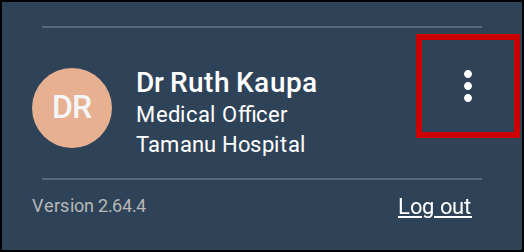

Move between the areas of Tamanu with the sidebar on the left of the screen. The sidebar is there on
every screen once you have logged in, and Tamanu opens on its first section, usually **Dashboard**.

# Before you start

The sidebar shows only the sections your site uses and your account can open, so yours may list
fewer sections than described here. Contact your system administrator if you believe you should be
able to open a section you cannot see.

# Open a page

1. Select a section in the sidebar, such as **Patients**.

   The section opens to list its pages, and any other open section closes. **Dashboard** has no pages
   under it, so it opens straight away.

2. Select the page you want.

   The page opens, and stays highlighted in the sidebar while you are on it. To close a section's list
   of pages, select the section again.

   You cannot leave a patient's record while you have a note open. Save or close the note first.

   

      
     Select a section, then select the page you want.
   

# Collapse and expand the sidebar

1. Select the arrow at the top of the sidebar, beside the Tamanu logo.

   The sidebar narrows to show only an icon for each section, leaving more room for the page.

2. To expand the sidebar again, select the arrow, or select any of the icons.

   Selecting an icon expands the sidebar without leaving the page you are on. If the section has pages
   under it, they are listed.

   

      
     Select the arrow to expand the sidebar.
   

# Get help

1. If the sidebar is collapsed, select the arrow at the top of the sidebar to expand it.

   The bottom of the sidebar shows your name, your role and the facility you are logged in to, with
   the Tamanu version number beneath. **Log out** is beside the version number. See
   [Log in and out](../01-accessing-tamanu/01-log-in-and-out.md).

2. Select the menu button, shown as three dots, beside your name.

   A menu opens. To change the language Tamanu is shown in, see
   [Change your language](../01-accessing-tamanu/03-change-language.md).

   

      
     Select the menu button beside your name.
   

3. Select **Support centre**.

   Your site's support centre opens in a new browser tab.
