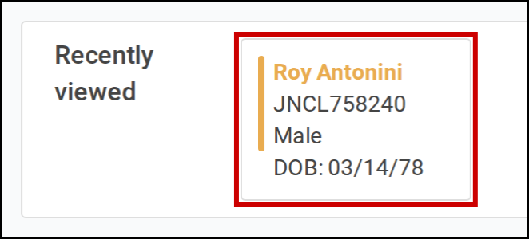
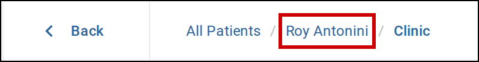

Get back to a patient you have opened recently, and move between the levels of their record. Start
from the **Dashboard**, or a patient list under **Patients** in the sidebar.

# Open a recently viewed patient

1. Open the **Dashboard**, or **All patients**, **Inpatients** or **Outpatients** under **Patients**.
   See [Use the sidebar](01-use-sidebar.md).

   **Recently viewed** lists the last 12 patients you have opened, the most recent first. On
   **Inpatients** it lists only those admitted to hospital, and on **Outpatients** only outpatients.
   On the patient lists, each patient also shows the type of their current encounter, such as
   **Clinic**, and you can select **Recently viewed** to hide or show the list.

   **Recently viewed** does not appear until you have opened a patient's record.

2. Select the patient.

   The patient's record opens.

   

      
     Select a patient in <b>Recently viewed</b> to open their record.
   

# Move between the levels of a record

The bar at the top of a patient's record shows where you are. It starts with the patient list you
came from, such as **All Patients** or **Inpatients**, then the patient's name, then the part of the
record you are in, such as an encounter. The last item is the page you are on.

1. Select an item in the bar to go to that level, or select **Back** to return to the page you were on
   before.

   You cannot leave the patient's record while you have a note open. Pointing at an item that would
   leave it shows **Cannot navigate away from patient with unsaved note**. Save or close the note
   first.

   

      
     Select a level in the bar, or select <b>Back</b>.
   

