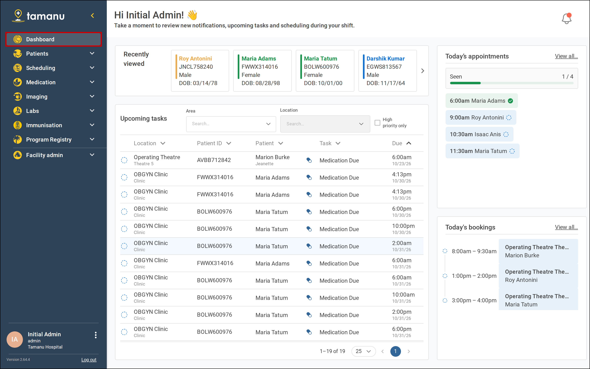
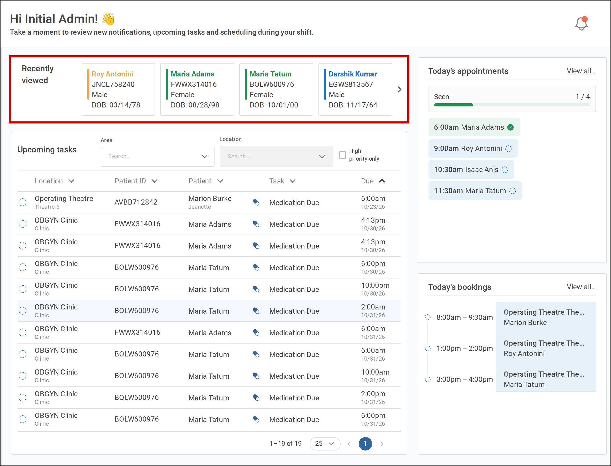
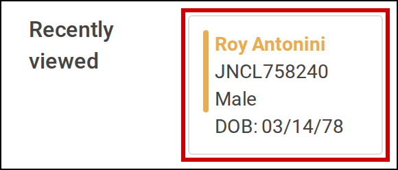
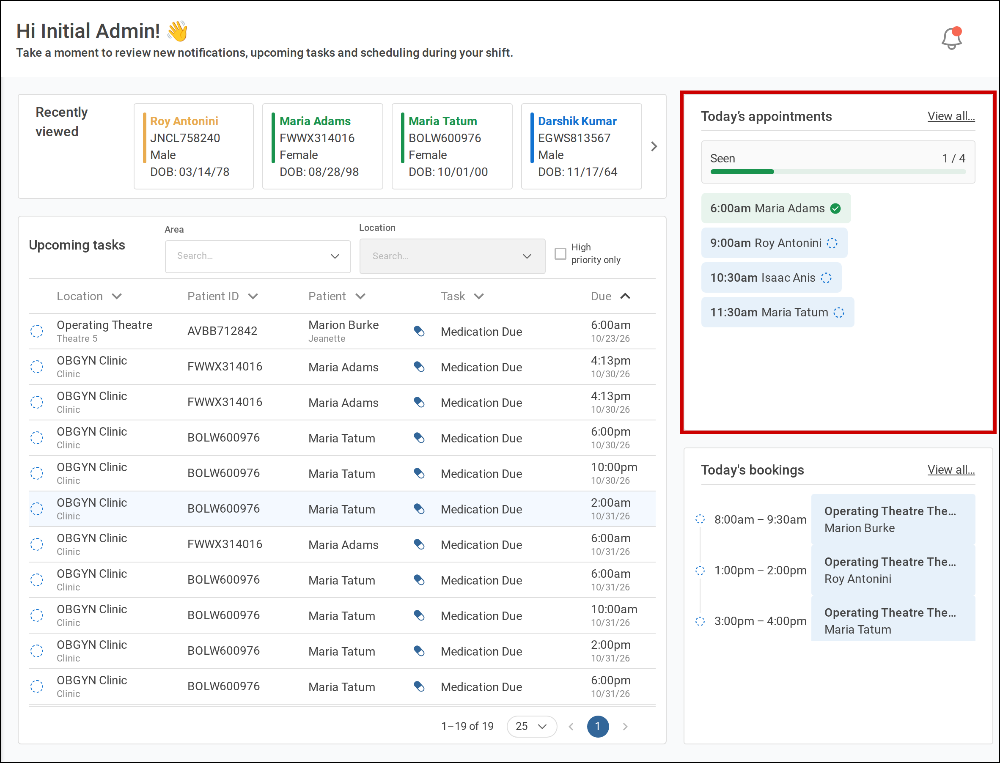
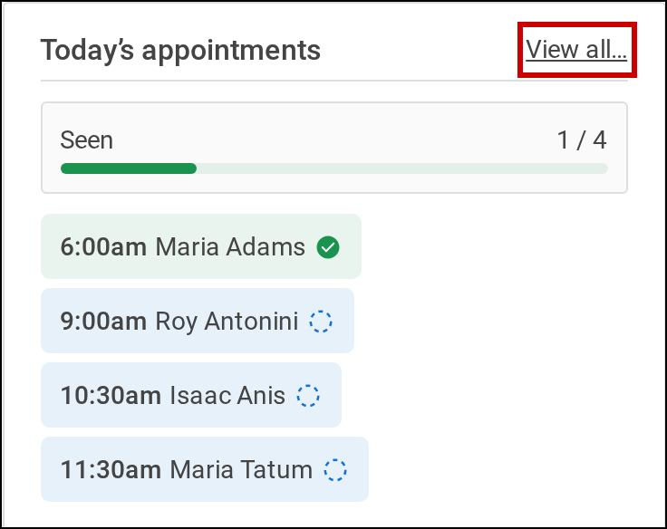
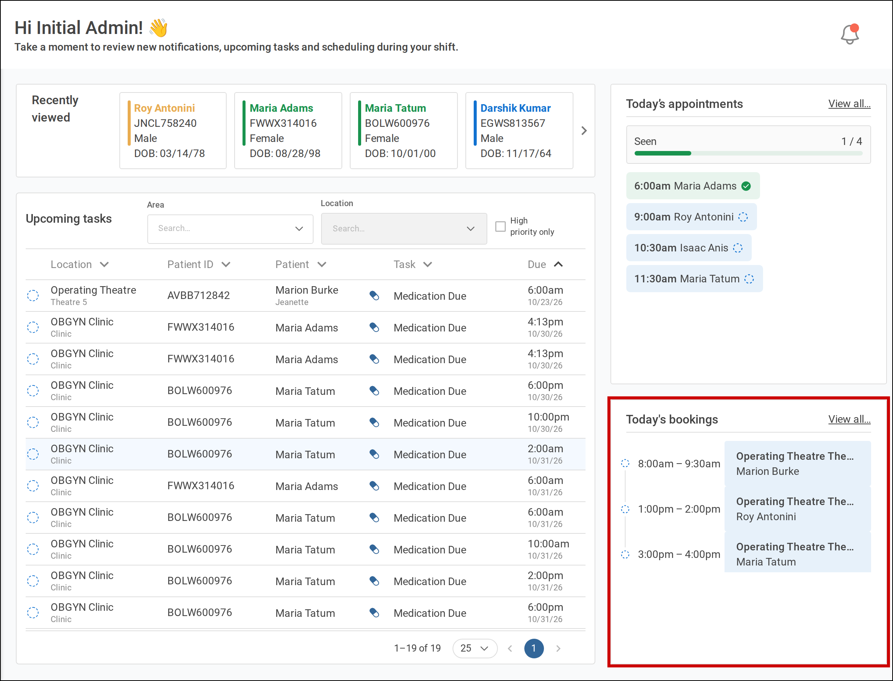
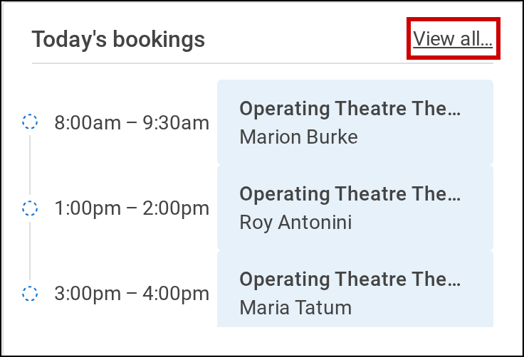
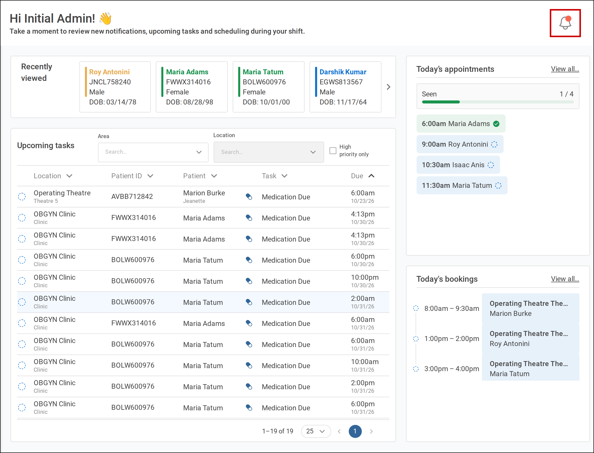
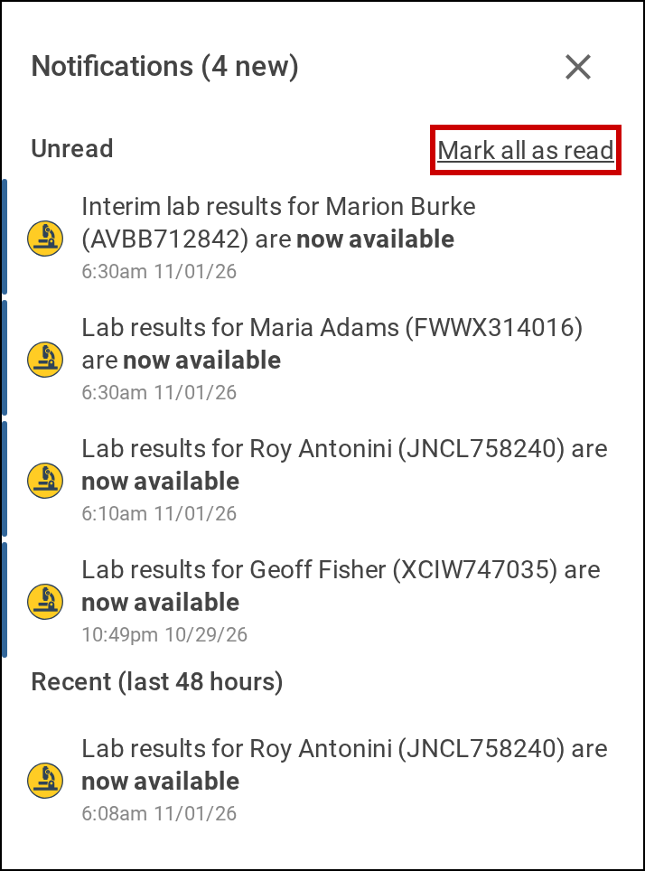

Your dashboard is the landing page for Tamanu, the screen you see each time you log in. It gathers
what you need for your shift: the patients you have looked at recently, your upcoming tasks, today's
appointments and bookings, and your notifications. To return to it, select **Dashboard** in the
sidebar.

   
  Select <b>Dashboard</b> in the sidebar to open your dashboard.

# Before you start

What your dashboard shows depends on your permissions and how your site is set up:

- **Upcoming tasks** shows only if your site uses tasks and you can view them. See
  [Work through your upcoming tasks](02-work-through-upcoming-tasks.md)
- **Today's appointments** shows only if you can view appointments and have been the clinician on at
  least one outpatient appointment
- **Today's bookings** shows only if you can view appointments and have been the clinician on at least
  one location booking

If none of these show, the dashboard shows **Welcome to Tamanu!** instead. Contact your system
administrator if you believe you should see a section that is missing.

# Open a recently viewed patient

**Recently viewed** appears at the top of the dashboard once you have opened a patient's record.

1. Find the patient in **Recently viewed**.

   Each card shows the patient's name, ID, sex and date of birth. If there are more patients than fit,
   select the arrows at either end of the row to see the rest.

   

      
     <b>Recently viewed</b> runs across the top of the dashboard.
   

2. Select the patient's card.

   The patient's record opens.

   

      
     Select a patient's card to open their record.
   

# Check today's appointments

1. Find **Today's appointments**.

   It lists the outpatient appointments you are the clinician for today. Each shows its time and the
   patient's name, and its colour and icon show its status. **Seen** above the list counts how many
   of today's appointments have been seen, and its bar fills as they are.

   If you have no appointments today, the pane says so. Select **Outpatient appointments** to see
   other appointments.

   

      
     <b>Today’s appointments</b> sits at the top right of the dashboard.
   

2. Select **View all…** to open the outpatient appointments calendar, grouped by clinician.

   

      
     Select <b>View all…</b> to open the outpatient appointments calendar.
   

# Check today's bookings

1. Find **Today's bookings**.

   It lists the location bookings you are the clinician for today. Each shows its time, its area and
   location, and the patient's name. The icon beside each booking shows its status.

   If you have no bookings today, the pane says so. Select **Location bookings** to see all bookings.

   

      
     <b>Today's bookings</b> sits below <b>Today’s appointments</b>.
   

2. Select **View all…** to open the location bookings calendar, showing only your bookings.

   

      
     Select <b>View all…</b> to open the location bookings calendar.
   

# Check your notifications

Tamanu notifies you when:

- results or interim results are available for a lab request you made, its results are amended or
  invalidated, or its sample is rejected
- results are available for an imaging request you made
- pharmacy adds a note to a medication you prescribed
- a medication you prescribed is recorded as not dispensed

1. Select the bell at the top right of the dashboard.

   A red dot on the bell means you have unread notifications.

   

      
     Select the bell at the top right of the dashboard.
   

   The **Notifications** panel opens on the right. Unread notifications are listed first, under
   **Unread**. Below them, **Recent** lists the notifications you have read in the last few hours; its
   heading says how many.

   

      
     The <b>Notifications</b> panel lists <b>Unread</b> notifications above <b>Recent</b> ones.
   

2. Select a notification to open it.

   The notification is marked as read, and the lab request, imaging request or the encounter's
   medications open.

3. To mark every unread notification as read without opening them, select **Mark all as read**.

4. To close the panel, select the cross at its top right, or anywhere outside it.
