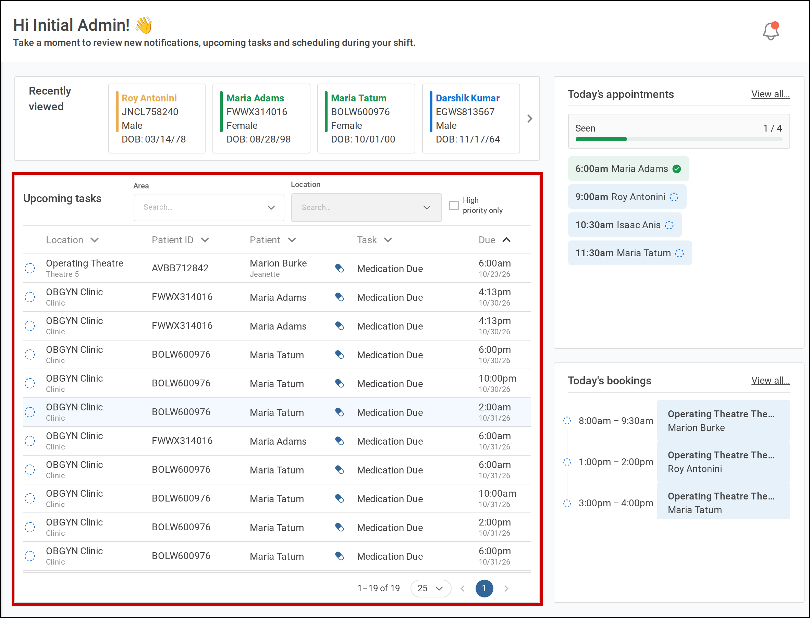
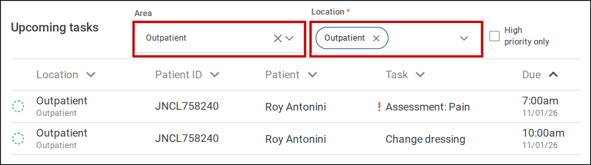

**Upcoming tasks** on your dashboard lists the tasks waiting to be done for patients at your facility,
so you can plan your shift. Start from your dashboard.

# Before you start

**Upcoming tasks** shows only if your site uses tasks and you have permission to view them. Contact
your system administrator if you believe you should see it.

# Steps

1. Find **Upcoming tasks** on your dashboard.

   It lists tasks still to be done for patients with an open encounter at this facility. It includes
   tasks for your designation, such as nurse, and tasks with no designation. It shows overdue tasks and
   those due in the next few hours, earliest first.

   A high priority task has a red exclamation mark beside its name. A task to give medication shows as
   **Medication Due**. Rest your pointer on a task to see who requested it and when.

   

      
     <b>Upcoming tasks</b> sits below <b>Recently viewed</b> on your dashboard.
   

2. To list only the patients in your care, choose an **Area**, then one or more beds in **Location**.

   Tamanu remembers your filters at this facility for next time.

   

      
     Choose an <b>Area</b> and <b>Location</b> to list only those patients' tasks.
   

3. To list only high priority tasks, tick **High priority only**.

4. To sort the list, select a column heading.

5. Select a task to open it.

   For most tasks, the patient's encounter opens on its **Tasks** tab, where you can mark the task as
   done. For a **Medication Due** task, the patient's **Medication admin record** opens.
